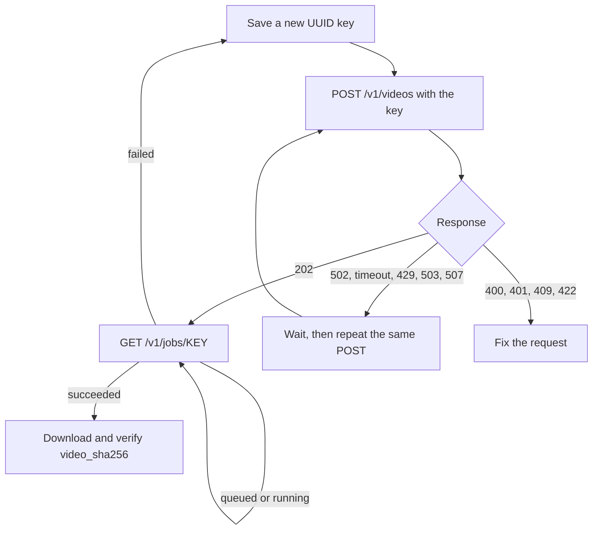

# Sol-H3 video API

Text-to-video and first-frame image-to-video, with synchronized audio, from
MiniMax H3-Base FL2VA with the four-step FastH3 adapter. Callers submit a
request, poll a job, and download an MP4 from one stable gateway. Requests use
the original `{prompt, duration, seed}` form or the
[SGLang MiniMax-H3 form](#sglang-form) (`task`, `conditions`, `target`). This
page is the contract for external services; operators use the
[deployment runbook](DEPLOYMENT.md).

| Item | Value |
|---|---|
| Base URL on the cluster network | `http://10.2.201.187:18080` |
| Base URL from elsewhere | `http://127.0.0.1:28080` through your own SSH tunnel ([Access](#access)) |
| Authentication | `Authorization: Bearer <token>` on every endpoint except `/healthz` |
| Output | 24 fps H.264 video with 32-kHz stereo AAC audio; 1344×768 by default, six aspect ratios or the first frame's own; 124–345 frames (5.17–14.375 s) |
| Capacity | Changes with the fleet: `workers_ready` (videos at a time) and `queue_capacity` in `/healthz` |

The base URL, token, and paths do not change when GPU workers are added or
removed. Never call a GPU worker's own address: only the gateway routes,
archives, and deduplicates jobs.

## Access

You need an SSH account on the cluster login host (unless your service already
runs on the cluster network) and the bearer token. Both come from the deployment
owner, Jeff.

- **Network.** `10.2.201.187` is a private address on the Fukushima H200 cluster.
  Elsewhere, run a tunnel with your own account and key on every host that makes
  calls, and keep it running:

  ```bash
  ssh -p 44222 -N -o ExitOnForwardFailure=yes -o ServerAliveInterval=30 \
    -L 127.0.0.1:28080:10.2.201.187:18080 <your-user>@157.66.255.187
  ```

  A tunnel serves only its own machine; each Ray worker host needs its own.
- **Token.** Keep it in a file only you can read (`chmod 600`, for example
  `~/.config/h3/token`) and load it from there. Never put it in a command-line
  argument, a log, a notebook, or a repository. Report a leak so it can be replaced.
- **Proxies.** The gateway is plain HTTP on a private address: bypass HTTP proxies
  (`curl --noproxy '*'`, `urllib.request.ProxyHandler({})`).

## Endpoints

| Method and path | Purpose | Success |
|---|---|---|
| `GET /healthz` | Gateway status and capacity; no token | 200 when ready, 503 otherwise |
| `POST /v1/videos` | Submit a generation | 202 with the [job object](#job-object) |
| `GET /v1/jobs/{id}` | Current state of a job | 200 with the job object |
| `GET /v1/jobs/{id}/video` | The finished MP4 (`video/mp4`) | 200 |
| `GET /v1/videos/{id}` | SGLang-style status: the same job object, `completed` instead of `succeeded` | 200 |
| `GET /v1/videos/{id}/content` | SGLang-style download of the finished MP4 | 200 |

Errors use FastAPI's shape, `{"detail": "<message>"}`; a 422 lists the invalid
fields instead, each with `loc` (the field path) and `msg`. Error responses never
echo request content, so a rejected image is not returned to you.

### `GET /healthz`

Returns `status` (`ready`, `unavailable`, or `storage_paused`), `idempotency_key`
(`true` when caller job IDs are supported), `workers_ready`, `gpus`, `queued`,
`queue_capacity`, `jobs_pending`, and storage diagnostics. `api` describes the
request contract the ready workers serve: `tasks`, `aspect_ratios`,
`short_edges`, `num_frames` (`min`, `max`, `step`), `image_formats`,
`max_image_bytes`, and `workers` (how many accept the SGLang form). During a
rolling upgrade `api.version` is 1 and only the original form is served.

### `POST /v1/videos`

| Header | Required | Value |
|---|---|---|
| `Authorization` | yes | `Bearer <token>` |
| `Content-Type` | yes | `application/json` |
| `Idempotency-Key` | recommended | A lowercase UUID, such as `str(uuid.uuid4())`; it becomes the job ID ([Retries](#idempotency-and-retries)) |

The body uses one of two forms: a body with a `task` field is the SGLang form,
any other body is the original form. Either way it must carry a `Content-Length`
header and be at most 28 MiB, which leaves room for a base64 first frame of up to
20 MiB.

#### Original form

| Body field | Type | Rules | Default |
|---|---|---|---|
| `prompt` | string | 1–8,000 characters, not only whitespace; surrounding whitespace is trimmed | required |
| `duration` | integer | `5` or `10` (seconds); the string `"5"` is rejected | `5` |
| `seed` | integer | 0 to 2^63−1; booleans are rejected | `42` |

No other fields are accepted. It renders 1344×768 text-to-video: 124 frames for
`5` and 243 frames for `10`.

#### SGLang form

This is the request body of `sglang serve --model-variant fl2va` from SGLang's
MiniMax-H3 cookbook, restricted to what this deployment runs.

| Field | Type | Rules | Default |
|---|---|---|---|
| `task` | string | `t2va` (text only) or `fl2va` (text and a first frame); `ref2va` is rejected | required |
| `prompt` | string | 1–8,000 characters, not only whitespace | required |
| `conditions` | array | `t2va`: empty. `fl2va`: exactly one `{"type": "image", "role": "keyframe", "frame_index": 0, "uri": ...}` | `[]` |
| `conditions[].uri` | string | A base64 image: `data:image/png;base64,...` (or `image/jpeg`, `image/webp`), or SGLang's `base64://...`. PNG, JPEG, or WebP; at most 20 MiB; sides of 32–8,192 pixels; at most 40 million pixels | required |
| `target.aspect_ratio` | string | `auto`, `21:9`, `16:9`, `4:3`, `1:1`, `3:4`, or `9:16` | `16:9` for `t2va`, `auto` for `fl2va` |
| `target.duration_seconds` | number | 4–15; converted to frames as described below, and the result must be 124–345 frames | `5.0` |
| `target.short_edge` | integer | `768` | `768` |
| `seed` | integer or null | 0 to 2^63−1 | `42` |
| `model`, `seconds` | string, number | Accepted for SGLang compatibility; `target.duration_seconds` wins over `seconds` | none |
| `num_outputs_per_prompt`, `n` | integer | `1` | `1` |

The following get a 422 that names the field:
- `num_inference_steps`, `flow_shift`, and `audio_flow_shift`: the four-step profile fixes them.
- `guidance_scale` and `negative_prompt`: the model is guidance-distilled.
- Any other unknown field.
- A last-frame keyframe (`frame_index: -1`), or two keyframes.
- Image URLs or file paths (`https://`, `file://`).

A request copied from SGLang's cookbook runs here once its
`num_inference_steps`, `flow_shift`, and `audio_flow_shift` are removed.

**Canvas.** The output follows MiniMax-H3's own geometry. The short edge is 768
pixels, the area is capped at 1344×768, and both sides are rounded to multiples
of 32.

| `aspect_ratio` | Output, width×height |
|---|---|
| `16:9`, or `auto` with `t2va` | 1344×768 |
| `9:16` | 768×1344 |
| `21:9` | 1536×672 |
| `4:3` | 1024×768 |
| `3:4` | 768×1024 |
| `1:1` | 768×768 |
| `auto` with `fl2va` | The first frame's own aspect ratio after EXIF rotation, which must be between 1:4 and 4:1. For example, 1080×1080 gives 768×768 and 1080×1620 gives 768×1152 |

The first frame is resized onto the canvas, as in MiniMax-H3 and SGLang. With
`auto` the canvas has the image's own shape. An explicit ratio stretches an
image of a different shape.

**Duration.** The valid frame counts are 124, 141, 158, and so on up to 345, every
17 frames. For an exact count, send `duration_seconds` as frames ÷ 24:
- 141 frames: 5.875
- 192 frames: 8.0
- 243 frames: 10.125
- 345 frames: 14.375

Other values round up to the next valid count; 8.5 s gives 209 frames (8.708 s).
Requests from about 4.48 s to 14.39 s are accepted. Shorter or longer ones get a 422.

**First frame is experimental.** The FastH3 adapter was distilled for
text-to-video only, and FastVideo did not train it with first- or last-frame
conditioning. `fl2va` runs MiniMax-H3's native first-frame path through that
adapter, so check the results for your use case.

Examples:

```json
{"task": "t2va", "prompt": "A red fox walks through a sunlit forest. Birds chirp.", "seed": 7,
 "target": {"aspect_ratio": "9:16", "duration_seconds": 8.0}}
```

```json
{"task": "fl2va", "prompt": "The woman in the photo turns and smiles; café chatter behind her.",
 "conditions": [{"type": "image", "role": "keyframe", "frame_index": 0, "uri": "data:image/jpeg;base64,/9j/4AAQ..."}],
 "target": {"aspect_ratio": "auto", "duration_seconds": 10.125}}
```

The 202 response is the job object in state `queued`, and rendering continues
after the response. For an original-form request:

```json
{"id": "1491ebf3-1b46-4ced-91ed-de5373f94c7f", "status": "queued", "created_at": 1793225519.17,
 "prompt": "A red fox walks through a sunlit forest. Birds chirp and leaves rustle.", "duration": 5, "seed": 7000,
 "status_url": "/v1/jobs/1491ebf3-1b46-4ced-91ed-de5373f94c7f",
 "video_url": "/v1/jobs/1491ebf3-1b46-4ced-91ed-de5373f94c7f/video"}
```

### `GET /v1/jobs/{id}`

Returns the job object. Poll every 1–2 seconds until `succeeded` or `failed`.
An unknown or malformed ID returns 404; 503 means job storage is briefly
unavailable, so poll again.

### `GET /v1/jobs/{id}/video`

Returns the MP4 once the job has `succeeded`: 409 before that, 410 if the file was
removed, 404 for an unknown ID. Downloads can be repeated at any time; videos do
not expire and are never rendered again.

## Job object

| Field | Present | Meaning |
|---|---|---|
| `id` | always | Job ID: your `Idempotency-Key`, or a random UUID without one |
| `status` | always | `queued`, `running`, `succeeded`, or `failed` |
| `prompt`, `seed` | always | The accepted request |
| `duration` | original form | The accepted `5` or `10` |
| `task` | always | `t2va` or `fl2va`; original-form jobs report `t2va` |
| `target`, `conditions` | SGLang form | The accepted request. Each condition reports `format`, `bytes`, and `sha256` of its image, never the image data |
| `output` | always | What is rendered: `width`, `height`, `num_frames`, `fps`, `duration_seconds` |
| `condition_sizes` | `fl2va` | The first frame's `width` and `height` after EXIF rotation |
| `created_at`, `started_at`, `finished_at` | as reached | Unix seconds |
| `status_url`, `video_url` | always | Paths relative to the base URL |
| `video_sha256`, `video_bytes` | `succeeded` | SHA-256 and size of the stored MP4; check your download against them |
| `media` | `succeeded` | `width`, `height`, `fps`, `video_codec`, `audio_codec`, `sample_rate`, `channels`, `duration_s` |
| `processing_s`, `pipeline_s` | `succeeded` | Worker time per video, end to end and for the model pipeline |
| `transformer_forwards`, `used_gate_fallback`, `memory`, `attention` | `succeeded` | Diagnostics: four forwards, whether the dense numerical fallback ran, per-GPU memory and attention counters |
| `stage` | `running`, upgraded workers | `generating`, `staging`, or `publishing`. Informational; keep polling `status` |
| `publication_mode`, `generation_started_at`, `generation_finished_at`, `gpu_slot_s`, `host`; with background publication also `staged_at`, `published_at`, `publication_slot_wait_s`, `publication_tail_s`, `encoder` | `succeeded`, upgraded workers | Timing diagnostics of the worker's GPU and publication phases; Unix seconds for `*_at` |
| `error`, `error_code` | `failed` | Message and stable code, below |
| `persistence_pending` | briefly | `true` while storage catches up; the status shows `running`, keep polling |

The gateway reports `running` until it has copied and checked the MP4, so
`succeeded` always means the video is ready to download.

| `error_code` | What happened |
|---|---|
| `worker_restarted` | The GPU worker restarted while the job was queued or running |
| `inference_failed` | The GPU worker failed during generation |
| `storage_failure` | Writing the output failed after generation |
| `worker_lost` | The job's worker stayed unreachable for 10 minutes |

Every code allows one regeneration with a **new** key. Jobs failed before
2026-10-28 may have `error` without `error_code`.

## Idempotency and retries

With an `Idempotency-Key`, every transport problem has one answer: repeat the
same POST with the same key. The gateway never renders that video twice.



| Response | Meaning | What to do |
|---|---|---|
| 202 | Accepted, or the existing job for a key already sent | Save the ID (it equals your key) and poll |
| 400 | `Idempotency-Key` is not a lowercase UUID, or a bad `Content-Length` | Fix the request; nothing started |
| 401 | Token missing or wrong | Fix the token |
| 409 | The key was already used with different inputs: prompt, duration, seed, task, target, or first-frame image | New inputs need a new key |
| 411, 413, 422 | No `Content-Length`, body over 28 MiB, or invalid fields (including an image that does not decode) | Fix the request; do not retry as is |
| 429 | Every worker queue is full; not accepted | Wait `Retry-After` (5 s) plus jitter, then repeat the same POST |
| 503 | No worker ready, new work paused, or (during an upgrade) no ready worker yet accepts this task or length; not accepted | Back off, then repeat the same POST |
| 507 | Storage refused the request; not accepted | Wait for recovery, then repeat |
| 502, timeout, or dropped connection | Outcome unknown: a worker may have accepted it | With a key: repeat the same POST and key. Without a key: do not repeat; ask the owner to reconcile |
| 502 with `detail.id` | Accepted, but the gateway has not recorded it yet | Poll that ID |

- **One key per video attempt.** Save it with your own record before sending;
  without it a lost response cannot be recovered. Keys never expire.
- **Retries reuse the key.** Duplicates sent at the same time share one dispatch.
  After a 502 the gateway asks only the worker it chose first; if that worker never
  answers, the key resolves to `failed` with `worker_lost` after 10 minutes.
- **Regeneration takes a new key.** Repeating a key that ended in `failed` returns
  the same failed job.
- **Lookup is the repeat.** `GET /v1/jobs/{key}` returns 404 until the gateway has
  recorded the job, so after a 502 repeat the POST rather than polling.
- **Without a key** the API behaves as before: never repeat a 502 automatically.

## Example client

This standard-library client ran against the production gateway on 2026-11-05 for
both a text-to-video and a first-frame request.

```python
"""Generate one H3 video through the gateway: submit with a key, poll, download, verify."""
import base64
import hashlib
import json
import os
from pathlib import Path
import random
import time
import urllib.error
import urllib.request
import uuid

BASE = os.environ.get("H3_BASE", "http://127.0.0.1:28080")  # http://10.2.201.187:18080 inside the cluster
TOKEN = Path(os.environ.get("H3_TOKEN_FILE", "~/.config/h3/token")).expanduser().read_text().strip()
OPENER = urllib.request.build_opener(urllib.request.ProxyHandler({}))  # Never go through a proxy.
IMAGE_TYPES = {".png": "image/png", ".jpg": "image/jpeg", ".jpeg": "image/jpeg", ".webp": "image/webp"}


def call(path, body=None, key=None, timeout=120):
    headers = {"Authorization": f"Bearer {TOKEN}"}
    data = None
    if body is not None:
        data = json.dumps(body).encode()
        headers["Content-Type"] = "application/json"
    if key:
        headers["Idempotency-Key"] = key
    with OPENER.open(urllib.request.Request(BASE + path, data=data, headers=headers), timeout=timeout) as response:
        return response.read()


def submit(body, key, attempts=8):
    """Repeat the same POST with the same key until the gateway gives a definite answer."""
    delay = 1.0
    for _ in range(attempts):
        try:
            return json.loads(call("/v1/videos", body, key))
        except urllib.error.HTTPError as error:
            if error.code not in (429, 502, 503, 507):
                raise  # 400, 401, 409, 422: fix the request instead of retrying.
            wait = float(error.headers.get("Retry-After") or delay)
        except (urllib.error.URLError, OSError):
            wait = delay  # Timeout or dropped connection: outcome unknown, the same key is safe.
        time.sleep(wait + random.uniform(0, delay))
        delay = min(delay * 2, 30.0)
    raise RuntimeError(f"Submission {key} is unresolved; repeat it later with the same key")


def request_body(prompt, image=None, aspect_ratio=None, duration_seconds=5.0, seed=42):
    """The SGLang form: text-to-video, or first-frame image-to-video when `image` is a file path."""
    target = {"duration_seconds": duration_seconds}
    if aspect_ratio:
        target["aspect_ratio"] = aspect_ratio  # Default: 16:9 for text, the image's own shape for a first frame.
    body = {"task": "fl2va" if image else "t2va", "prompt": prompt, "seed": seed, "target": target}
    if image:
        path = Path(image)
        uri = f"data:{IMAGE_TYPES[path.suffix.lower()]};base64," + base64.b64encode(path.read_bytes()).decode()
        body["conditions"] = [{"type": "image", "role": "keyframe", "frame_index": 0, "uri": uri}]
    return body


def generate(body, output="video.mp4", key=None, deadline_s=3600):
    key = key or str(uuid.uuid4())  # Save it with your record before submitting: it is the job ID.
    job = submit(body, key)
    started = time.monotonic()
    while job["status"] not in ("succeeded", "failed"):
        if time.monotonic() - started > deadline_s:
            raise TimeoutError(f"Job {key} is still {job['status']}; poll it later, do not resubmit")
        time.sleep(2)
        try:
            job = json.loads(call(f"/v1/jobs/{key}"))
        except (urllib.error.URLError, OSError):
            pass  # Polling is always safe to repeat.
    if job["status"] == "failed":
        raise RuntimeError(f"Job {key} failed with {job.get('error_code')}: {job.get('error')}")
    for _ in range(3):
        try:
            data = call(f"/v1/jobs/{key}/video", timeout=300)
        except (urllib.error.URLError, OSError):
            continue
        if len(data) == job["video_bytes"] and hashlib.sha256(data).hexdigest() == job["video_sha256"]:
            Path(output).write_bytes(data)
            return job
    raise RuntimeError(f"Could not download a verified copy of {key}; download it again later")


if __name__ == "__main__":
    fox = request_body("A red fox walks through a sunlit forest. Birds chirp and leaves rustle.",
                       aspect_ratio="9:16", duration_seconds=8.0)
    job = generate(fox, output="fox.mp4")
    print(job["id"], job["output"], round(job["processing_s"], 1), job["video_sha256"][:16])
    photo = request_body("The scene in the photo comes alive with gentle motion and ambient sound.",
                         image="first_frame.png")
    job = generate(photo, output="photo.mp4")
    print(job["id"], job["output"], round(job["processing_s"], 1), job["video_sha256"][:16])
```

`generate()` takes either form, so `generate({"prompt": "...", "duration": 5, "seed": 42})`
still works. To resume after your own process restarts, call
`generate(body, key=<saved key>)`: the same key returns the original job. To
regenerate after `failed`, call `generate()` without a key so it makes a new one.

With curl 7.55 or newer, a header file keeps the token off the command line:

```bash
# Once: a header file only you can read.
umask 077; mkdir -p ~/.config/h3
{ printf 'Authorization: Bearer '; cat ~/.config/h3/token; } > ~/.config/h3/auth.header

BASE=http://127.0.0.1:28080
AUTH=(--noproxy '*' -sS -H @"$HOME/.config/h3/auth.header")
curl --noproxy '*' -sS "$BASE/healthz"

# Original form.
KEY=$(python3 -c 'import uuid; print(uuid.uuid4())')
curl "${AUTH[@]}" -H 'Content-Type: application/json' -H "Idempotency-Key: $KEY" \
  -d '{"prompt": "A red fox walks through a sunlit forest.", "duration": 5, "seed": 42}' "$BASE/v1/videos"
curl "${AUTH[@]}" "$BASE/v1/jobs/$KEY"    # repeat until succeeded
curl "${AUTH[@]}" -o fox.mp4 "$BASE/v1/jobs/$KEY/video"
sha256sum fox.mp4    # must equal video_sha256 from the status

# SGLang form with a first frame. Build the body in a file: base64 images are large.
python3 -c 'import base64, json, sys; print(json.dumps({"task": "fl2va", "prompt": sys.argv[2],
  "target": {"duration_seconds": 8.0}, "conditions": [{"type": "image", "role": "keyframe", "frame_index": 0,
  "uri": "data:image/png;base64," + base64.b64encode(open(sys.argv[1], "rb").read()).decode()}]}))' \
  first_frame.png "The photo comes alive." > body.json
KEY=$(python3 -c 'import uuid; print(uuid.uuid4())')
curl "${AUTH[@]}" -H 'Content-Type: application/json' -H "Idempotency-Key: $KEY" \
  --data-binary @body.json "$BASE/v1/videos"
curl "${AUTH[@]}" "$BASE/v1/videos/$KEY"    # SGLang-style status: repeat until completed
curl "${AUTH[@]}" -o photo.mp4 "$BASE/v1/videos/$KEY/content"
```

## Capacity and latency

The fleet is shared by every caller. Start with at most one job in flight per
ready worker (`workers_ready` in `/healthz`) across all of your processes, counting
submit through download. Batch callers can raise that toward two per worker while
latency and 429s stay low. Tell the owner before a batch of hundreds: each worker
queues only 8 jobs, so this is not a durable batch queue.

| Clip | Text-to-video, warm | First frame, warm | Dense fallback, warm | First request of a new length | MP4 size |
|---|---|---|---|---|---|
| 124 frames, 5.2 s | 13.5 s | 15.2 s | 17–19 s | 26–28 s | about 1–4 MB |
| 243 frames, 10.1 s | 32 s | 34 s | 46–48 s | 42–53 s | about 1–7 MB |
| 345 frames, 14.4 s | 52 s | 56 s | 79–82 s | 65–90 s | about 2–13 MB |

These are worker times per video on a two-GPU H200 worker, measured on 2026-11-05
at 1344×768 with prompts of about 2,000 characters. Other aspect ratios have the
same or fewer tokens per frame. Queueing and download are not included.

- **Dense fallback.** When the sparse attention's numerical check rejects a
  prompt length, that length runs dense on that worker from then on. This
  happened to 6–25% of 5- and 10-second requests and to about half of
  14-second ones in the measurement. It happens more often with very long
  prompts: 14.4-second clips with 8,000-character prompts took 82–99 s.
- **New lengths.** A worker's first request with a new combination of prompt
  length, canvas, and frame count compiles kernels once. That is the "first
  request of a new length" column.
- **Capacity.** Longer clips occupy a worker for longer: one 14.4-second clip
  costs about four 5-second clips. Plan concurrency in worker time, not job
  count. A
gateway restart stops answers for about 7 minutes while it reloads job records;
rendering continues, so keep retrying with the same key and keep polling.

## Troubleshooting

| Symptom | Likely cause | Fix |
|---|---|---|
| Connection refused on `127.0.0.1:28080` | Your SSH tunnel stopped | Restart the tunnel |
| `/healthz` is 503 with `workers_ready` 0 | No GPU workers during maintenance | Wait; new POSTs return 503 with `Retry-After` |
| Every call hangs for minutes, then works | The gateway is restarting | Keep retrying with the same key |
| 401 | Token missing or mistyped, or stray characters in the header file | Recreate the header file from the token file |
| 404 on poll right after a 502 | The gateway has not recorded the job | Repeat the POST with the same key |
| 502 on the same key for 10 minutes | Its worker is unreachable | The key ends as `failed`, `worker_lost`; regenerate with a new key |
| 422 naming `conditions[0].uri` | The first frame is not base64 PNG, JPEG, or WebP, does not decode, is over 20 MiB, or (with `auto`) is wider than 4:1 or taller than 1:4 | Fix the image; for an extreme shape, send an explicit `aspect_ratio` |
| 422 naming `num_inference_steps`, `flow_shift`, or `audio_flow_shift` | Fields copied from SGLang's cookbook that this deployment fixes | Remove them |
| 503 saying no ready worker accepts the task or length | Workers are being upgraded and none of the new ones is ready yet | Back off and repeat the same POST |

Jobs cannot be found by prompt, so save the key before every POST. For access,
the token, large batches, and incidents, contact the deployment owner, Jeff.

## Changelog

| Date | Change |
|---|---|
| 2026-11-09 | Additive job fields: `stage` while running, and timing diagnostics. Workers publish a video while generating the next. Status values, existing fields, and their meaning, including `processing_s`, are unchanged |
| 2026-11-05 | The SGLang MiniMax-H3 request form: `t2va` and first-frame `fl2va` with base64 images, six aspect ratios or the image's own, 124–345 frames; `/v1/videos/{id}` and `/v1/videos/{id}/content`; `task`, `target`, `conditions`, and `output` on jobs; `api` in `/healthz`; 28 MiB request limit. The original form is unchanged |
| 2026-10-28 | Optional `Idempotency-Key` (the job ID); `error_code` on failed jobs, including `worker_lost`; `video_sha256` and `video_bytes` on succeeded jobs; `idempotency_key` in `/healthz` |
| 2026-10-22 | Stable gateway URL with job archive and polling |
