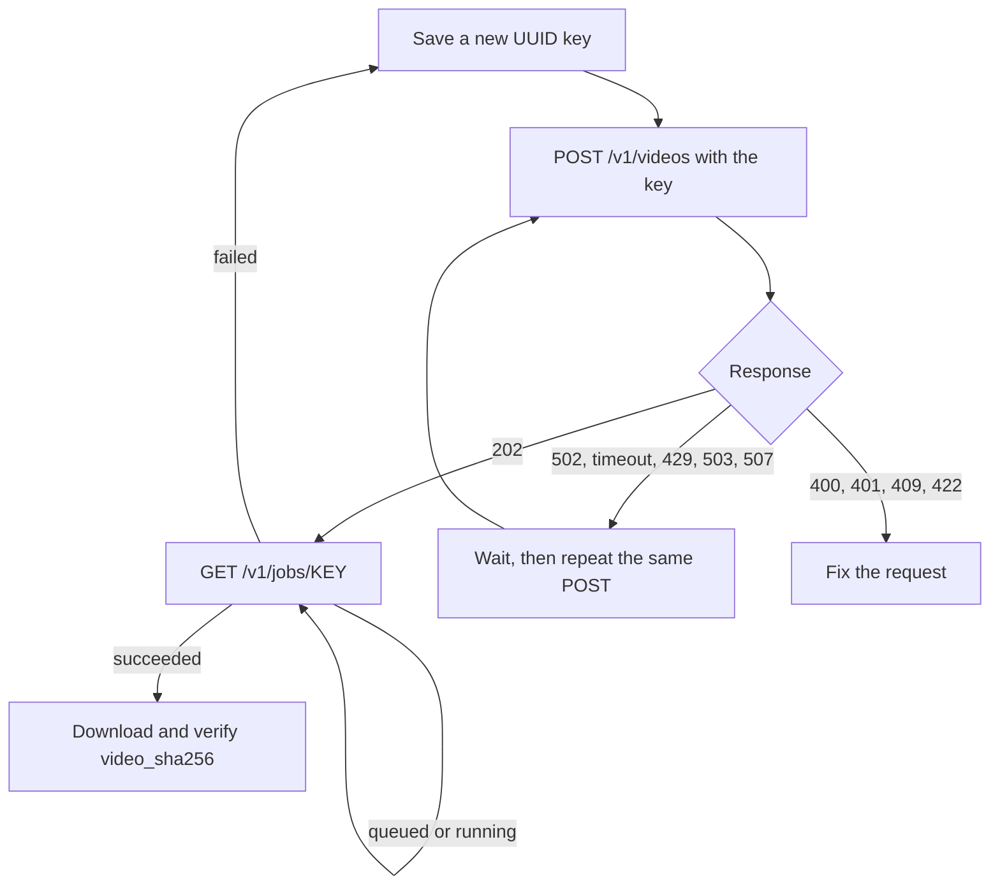

# Sol-H3 video API

Text-to-video with synchronized audio from MiniMax H3-Base FL2VA with the
four-step FastH3 adapter. Callers submit a prompt, poll a job, and download an
MP4 from one stable gateway. This page is the contract for external services;
operators use the [deployment runbook](DEPLOYMENT.md).

| Item | Value |
|---|---|
| Base URL on the cluster network | `http://10.2.201.187:18080` |
| Base URL from elsewhere | `http://127.0.0.1:28080` through your own SSH tunnel ([Access](#access)) |
| Authentication | `Authorization: Bearer <token>` on every endpoint except `/healthz` |
| Output | 1344×768, 24 fps, H.264 video with stereo AAC audio, 5 or 10 seconds |
| Capacity on 2026-10-28 | 16 H200 workers: 16 videos at a time, 128 more queued; live values in `/healthz` |

The base URL, token, and paths do not change when GPU workers are added or
removed. Never call a GPU worker's own address: only the gateway routes,
archives, and deduplicates jobs.

## Access

You need an SSH account on the cluster login host (unless your service already
runs on the cluster network) and the bearer token. Both come from the deployment
owner, Jeff.

- **Network.** `10.2.201.187` is a private address on the Fukushima H200 cluster.
  Elsewhere, run a tunnel with your own account and key on every host that makes
  calls, and keep it running:

  ```bash
  ssh -p 44222 -N -o ExitOnForwardFailure=yes -o ServerAliveInterval=30 \
    -L 127.0.0.1:28080:10.2.201.187:18080 <your-user>@157.66.255.187
  ```

  A tunnel serves only its own machine; each Ray worker host needs its own.
- **Token.** Keep it in a file only you can read (`chmod 600`, for example
  `~/.config/h3/token`) and load it from there. Never put it in a command-line
  argument, a log, a notebook, or a repository. Report a leak so it can be replaced.
- **Proxies.** The gateway is plain HTTP on a private address: bypass HTTP proxies
  (`curl --noproxy '*'`, `urllib.request.ProxyHandler({})`).

## Endpoints

| Method and path | Purpose | Success |
|---|---|---|
| `GET /healthz` | Gateway status and capacity; no token | 200 when ready, 503 otherwise |
| `POST /v1/videos` | Submit a generation | 202 with the [job object](#job-object) |
| `GET /v1/jobs/{id}` | Current state of a job | 200 with the job object |
| `GET /v1/jobs/{id}/video` | The finished MP4 (`video/mp4`) | 200 |

Errors use FastAPI's shape, `{"detail": "<message>"}`; a 422 lists the invalid
fields instead.

### `GET /healthz`

Returns `status` (`ready`, `unavailable`, or `storage_paused`), `idempotency_key`
(`true` when caller job IDs are supported), `workers_ready`, `gpus`, `queued`,
`queue_capacity`, `jobs_pending`, and storage diagnostics.

### `POST /v1/videos`

| Header | Required | Value |
|---|---|---|
| `Authorization` | yes | `Bearer <token>` |
| `Content-Type` | yes | `application/json` |
| `Idempotency-Key` | recommended | A lowercase UUID, such as `str(uuid.uuid4())`; it becomes the job ID ([Retries](#idempotency-and-retries)) |

| Body field | Type | Rules | Default |
|---|---|---|---|
| `prompt` | string | 1–8,000 characters, not only whitespace; surrounding whitespace is trimmed | required |
| `duration` | integer | `5` or `10` (seconds); the string `"5"` is rejected | `5` |
| `seed` | integer | 0 to 2^63−1; booleans are rejected | `42` |

No other fields are accepted. The body must be at most 32 KiB and carry a
`Content-Length` header. The 202 response is the job object in state `queued`;
rendering continues after the response:

```json
{"id": "1491ebf3-1b46-4ced-91ed-de5373f94c7f", "status": "queued", "created_at": 1793225519.17,
 "prompt": "A red fox walks through a sunlit forest. Birds chirp and leaves rustle.", "duration": 5, "seed": 7000,
 "status_url": "/v1/jobs/1491ebf3-1b46-4ced-91ed-de5373f94c7f",
 "video_url": "/v1/jobs/1491ebf3-1b46-4ced-91ed-de5373f94c7f/video"}
```

### `GET /v1/jobs/{id}`

Returns the job object. Poll every 1–2 seconds until `succeeded` or `failed`.
An unknown or malformed ID returns 404; 503 means job storage is briefly
unavailable, so poll again.

### `GET /v1/jobs/{id}/video`

Returns the MP4 once the job has `succeeded`: 409 before that, 410 if the file was
removed, 404 for an unknown ID. Downloads can be repeated at any time; videos do
not expire and are never rendered again.

## Job object

| Field | Present | Meaning |
|---|---|---|
| `id` | always | Job ID: your `Idempotency-Key`, or a random UUID without one |
| `status` | always | `queued`, `running`, `succeeded`, or `failed` |
| `prompt`, `duration`, `seed` | always | The accepted request |
| `created_at`, `started_at`, `finished_at` | as reached | Unix seconds |
| `status_url`, `video_url` | always | Paths relative to the base URL |
| `video_sha256`, `video_bytes` | `succeeded` | SHA-256 and size of the stored MP4; check your download against them |
| `media` | `succeeded` | `width`, `height`, `fps`, `video_codec`, `audio_codec`, `sample_rate`, `channels`, `duration_s` |
| `processing_s`, `pipeline_s` | `succeeded` | Worker time per video, end to end and for the model pipeline |
| `transformer_forwards`, `used_gate_fallback`, `memory`, `attention` | `succeeded` | Diagnostics: four forwards, whether the dense numerical fallback ran, per-GPU memory and attention counters |
| `error`, `error_code` | `failed` | Message and stable code, below |
| `persistence_pending` | briefly | `true` while storage catches up; the status shows `running`, keep polling |

The gateway reports `running` until it has copied and checked the MP4, so
`succeeded` always means the video is ready to download.

| `error_code` | What happened |
|---|---|
| `worker_restarted` | The GPU worker restarted while the job was queued or running |
| `inference_failed` | The GPU worker failed during generation |
| `storage_failure` | Writing the output failed after generation |
| `worker_lost` | The job's worker stayed unreachable for 10 minutes |

Every code allows one regeneration with a **new** key. Jobs failed before
2026-10-28 may have `error` without `error_code`.

## Idempotency and retries

With an `Idempotency-Key`, every transport problem has one answer: repeat the
same POST with the same key. The gateway never renders that video twice.



| Response | Meaning | What to do |
|---|---|---|
| 202 | Accepted, or the existing job for a key already sent | Save the ID (it equals your key) and poll |
| 400 | `Idempotency-Key` is not a lowercase UUID, or a bad `Content-Length` | Fix the request; nothing started |
| 401 | Token missing or wrong | Fix the token |
| 409 | The key was already used with a different prompt, duration, or seed | New inputs need a new key |
| 411, 413, 422 | No `Content-Length`, body over 32 KiB, or invalid fields | Fix the request; do not retry as is |
| 429 | Every worker queue is full; not accepted | Wait `Retry-After` (5 s) plus jitter, then repeat the same POST |
| 503 | No worker ready, or new work paused; not accepted | Back off, then repeat the same POST |
| 507 | Storage refused the request; not accepted | Wait for recovery, then repeat |
| 502, timeout, or dropped connection | Outcome unknown: a worker may have accepted it | With a key: repeat the same POST and key. Without a key: do not repeat; ask the owner to reconcile |
| 502 with `detail.id` | Accepted, but the gateway has not recorded it yet | Poll that ID |

- **One key per video attempt.** Save it with your own record before sending;
  without it a lost response cannot be recovered. Keys never expire.
- **Retries reuse the key.** Duplicates sent at the same time share one dispatch.
  After a 502 the gateway asks only the worker it chose first; if that worker never
  answers, the key resolves to `failed` with `worker_lost` after 10 minutes.
- **Regeneration takes a new key.** Repeating a key that ended in `failed` returns
  the same failed job.
- **Lookup is the repeat.** `GET /v1/jobs/{key}` returns 404 until the gateway has
  recorded the job, so after a 502 repeat the POST rather than polling.
- **Without a key** the API behaves as before: never repeat a 502 automatically.

## Example client

This standard-library client ran against the live gateway on 2026-10-28.

```python
"""Generate one H3 video through the gateway: submit with a key, poll, download, verify."""
import hashlib
import json
import os
from pathlib import Path
import random
import time
import urllib.error
import urllib.request
import uuid

BASE = os.environ.get("H3_BASE", "http://127.0.0.1:28080")  # http://10.2.201.187:18080 inside the cluster
TOKEN = Path(os.environ.get("H3_TOKEN_FILE", "~/.config/h3/token")).expanduser().read_text().strip()
OPENER = urllib.request.build_opener(urllib.request.ProxyHandler({}))  # Never go through a proxy.


def call(path, body=None, key=None, timeout=60):
    headers = {"Authorization": f"Bearer {TOKEN}"}
    data = None
    if body is not None:
        data = json.dumps(body).encode()
        headers["Content-Type"] = "application/json"
    if key:
        headers["Idempotency-Key"] = key
    with OPENER.open(urllib.request.Request(BASE + path, data=data, headers=headers), timeout=timeout) as response:
        return response.read()


def submit(body, key, attempts=8):
    """Repeat the same POST with the same key until the gateway gives a definite answer."""
    delay = 1.0
    for _ in range(attempts):
        try:
            return json.loads(call("/v1/videos", body, key))
        except urllib.error.HTTPError as error:
            if error.code not in (429, 502, 503, 507):
                raise  # 400, 401, 409, 422: fix the request instead of retrying.
            wait = float(error.headers.get("Retry-After") or delay)
        except (urllib.error.URLError, OSError):
            wait = delay  # Timeout or dropped connection: outcome unknown, the same key is safe.
        time.sleep(wait + random.uniform(0, delay))
        delay = min(delay * 2, 30.0)
    raise RuntimeError(f"Submission {key} is unresolved; repeat it later with the same key")


def generate(prompt, duration=5, seed=42, output="video.mp4", key=None, deadline_s=1800):
    key = key or str(uuid.uuid4())  # Save it with your record before submitting: it is the job ID.
    job = submit({"prompt": prompt, "duration": duration, "seed": seed}, key)
    started = time.monotonic()
    while job["status"] not in ("succeeded", "failed"):
        if time.monotonic() - started > deadline_s:
            raise TimeoutError(f"Job {key} is still {job['status']}; poll it later, do not resubmit")
        time.sleep(2)
        try:
            job = json.loads(call(f"/v1/jobs/{key}"))
        except (urllib.error.URLError, OSError):
            pass  # Polling is always safe to repeat.
    if job["status"] == "failed":
        raise RuntimeError(f"Job {key} failed with {job.get('error_code')}: {job.get('error')}")
    for _ in range(3):
        try:
            data = call(f"/v1/jobs/{key}/video", timeout=300)
        except (urllib.error.URLError, OSError):
            continue
        if len(data) == job["video_bytes"] and hashlib.sha256(data).hexdigest() == job["video_sha256"]:
            Path(output).write_bytes(data)
            return job
    raise RuntimeError(f"Could not download a verified copy of {key}; download it again later")


if __name__ == "__main__":
    job = generate("A red fox walks through a sunlit forest. Birds chirp and leaves rustle.", duration=5, seed=42)
    print(job["id"], job["status"], round(job["processing_s"], 1), job["video_sha256"][:16])
```

To resume after your own process restarts, call `generate(..., key=<saved key>)`:
the same key returns the original job. To regenerate after `failed`, call
`generate()` without a key so it makes a new one.

With curl 7.55 or newer, a header file keeps the token off the command line:

```bash
# Once: a header file only you can read.
umask 077; mkdir -p ~/.config/h3
{ printf 'Authorization: Bearer '; cat ~/.config/h3/token; } > ~/.config/h3/auth.header

BASE=http://127.0.0.1:28080
KEY=$(python3 -c 'import uuid; print(uuid.uuid4())')
curl --noproxy '*' -sS "$BASE/healthz"
curl --noproxy '*' -sS -H @"$HOME/.config/h3/auth.header" -H 'Content-Type: application/json' \
  -H "Idempotency-Key: $KEY" \
  -d '{"prompt": "A red fox walks through a sunlit forest.", "duration": 5, "seed": 42}' "$BASE/v1/videos"
curl --noproxy '*' -sS -H @"$HOME/.config/h3/auth.header" "$BASE/v1/jobs/$KEY"    # repeat until succeeded
curl --noproxy '*' -sS -H @"$HOME/.config/h3/auth.header" -o fox.mp4 "$BASE/v1/jobs/$KEY/video"
sha256sum fox.mp4    # must equal video_sha256 from the status
```

## Capacity and latency

The fleet is shared by every caller. Start with at most 16 jobs in flight across
all of your processes, counting submit through download, and raise toward 20
only while latency and 429s stay low. Tell the owner before a batch of hundreds:
each worker queues only 8 jobs, so this is not a durable batch queue.

| Clip | Worker time per video, warm | MP4 size |
|---|---|---|
| 5 s | about 13 s | about 2.2–2.4 MB |
| 10 s | about 31 s; 45–53 s when the prompt triggers the dense numerical fallback | about 6.9 MB |

Times exclude queueing and download, measured on H200 on 2026-10-22 and
2026-10-28. A worker's first prompt of a new length adds about 10–20 s once. A
gateway restart stops answers for about 7 minutes while it reloads job records;
rendering continues, so keep retrying with the same key and keep polling.

## Troubleshooting

| Symptom | Likely cause | Fix |
|---|---|---|
| Connection refused on `127.0.0.1:28080` | Your SSH tunnel stopped | Restart the tunnel |
| `/healthz` is 503 with `workers_ready` 0 | No GPU workers during maintenance | Wait; new POSTs return 503 with `Retry-After` |
| Every call hangs for minutes, then works | The gateway is restarting | Keep retrying with the same key |
| 401 | Token missing or mistyped, or stray characters in the header file | Recreate the header file from the token file |
| 404 on poll right after a 502 | The gateway has not recorded the job | Repeat the POST with the same key |
| 502 on the same key for 10 minutes | Its worker is unreachable | The key ends as `failed`, `worker_lost`; regenerate with a new key |

Jobs cannot be found by prompt, so save the key before every POST. For access,
the token, large batches, and incidents, contact the deployment owner, Jeff.

## Changelog

| Date | Change |
|---|---|
| 2026-10-28 | Optional `Idempotency-Key` (the job ID); `error_code` on failed jobs, including `worker_lost`; `video_sha256` and `video_bytes` on succeeded jobs; `idempotency_key` in `/healthz` |
| 2026-10-22 | Stable gateway URL with job archive and polling |
