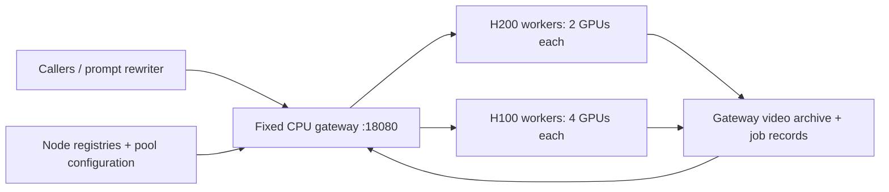

# H3 service design and redeployment runbook

This is the operating contract for Jeff's self-hosted **H3-Base FL2VA + four-step
FastH3 adapter** service. It covers `serve.py`, `serve_node.py`, `gateway.py`, and
the launchers in this directory. It does not use the separate SGLang deployment
instructions at the repository root.

**Last recorded operational state: 2026-10-28, sixteen H200 workers serving.** The
gateway and workers run the 2026-10-28 code: caller job IDs, `error_code`,
`video_sha256`, and the 2026-10-27 storage hardening. Four eight-GPU allocations
each serve four two-GPU workers on ports 18080–18083: H200-0002 (Slurm 3891),
0005 (3892), 0006 (3893), and 0023 (3894). That is 32 GPUs, 16 generation slots,
and 128 queue slots. Each worker passed a 5-second and a 10-second fallback
request directly before admission; then requests through the gateway covered
every worker, with checksums, repeated keys, 409 conflicts, and no-rerender
replays verified. Evidence is in `deployment/h200-0002-20261028/` and
`deployment/scale-0005-0006-0023-20261028/`. H200-0048 remains stopped and
excluded. A two-worker H100 launch on GMI node `gmicloud-loki-gpu-004`
(Slurm 3435) failed while loading the model: every rank holds the whole pipeline,
about 129 GiB, and an H100 has 80 GB (see
[H100 workers](#h100-workers-on-another-cluster)). Do not interpret this document
or a stale registry as an instruction to restart or stop workers.

## Fixed caller contract

| Item | Contract |
|---|---|
| External base URL | **`http://10.2.201.187:18080`** |
| Gateway login | `ssh -i ~/.ssh/gmi -p 44222 jeff@157.66.255.187` |
| Deployment root on that cluster | `/home/jeff/sol-h3-h200` |
| Bearer token | Existing `deployment/token`; keep private and preserve it |
| Submit | `POST /v1/videos`, JSON `prompt`, `duration` (5 or 10), `seed` |
| Caller job ID | Optional `Idempotency-Key: <lowercase UUID>` header; it becomes the job ID |
| Poll / download | `GET /v1/jobs/{id}` / `GET /v1/jobs/{id}/video`; success includes `video_sha256` |
| Media | 1344×768, 24 FPS, stereo audio, four transformer forwards |

The caller-facing reference, with a tested example client, is [API.md](API.md);
keep it in step with this contract. The base URL, bearer token, API paths, and
existing job IDs survive worker pool changes. Preserve the gateway's `jobs/`, `videos/`, `uncertain/`, `pool.json`, and
`endpoint.json`. Worker ports are internal; retaining their existing ranges is
still useful when replacing an allocation on the same host. **Never move the
gateway onto a GPU Slurm allocation.**

`h3-gateway.socket` owns the listener on the persistent login host.
`deploy_h200_gateway.sh` checks the pinned `gateway/endpoint.json` and refuses
address drift. Ordinary worker scaling requires neither running that installer
nor restarting the gateway. Updating gateway code requires a service restart;
keeping the socket open preserves the address but does not guarantee that an
in-flight HTTP request survives a process restart.

Clients outside the private network use their own SSH tunnel, as described in
[the access guide](README.md#access-the-deployed-h200-service). Cluster access
and the token must be provisioned through the deployment owner. Do not copy a
private key into a document or put the bearer token into shell arguments/logs.
The prompt rewriter continues to use the gateway URL, independently of GPU type
and worker count.

## Request ownership, concurrency, and failures



Each worker runs one generation at a time, with eight waiting requests. The
gateway chooses a healthy worker using observed queue depth, accepted jobs, and
submissions in progress. This is a bounded worker queue, not a durable global
queue for an arbitrary batch of 400 requests. With `W` healthy workers, there
are `W` generation slots and up to `8 × W` waiting slots. A useful initial caller
limit is `W`, increasing toward `1.25 × W` after measuring queueing and latency.
The former 16-worker pool used **20 external concurrent jobs**, counting the
whole submit → poll → download lifecycle across callers. Recalculate after
scaling; this is not a guarantee against rejection or failure.

A job stays on the worker that accepted it, including while that worker is
excluded from new dispatch. The gateway copies and checks the MP4 before
publishing success. It keeps retrying status/archive operations after a transient
failure, without generating the video again. Completed archives remain available
with an empty worker pool, provided their storage is readable.

| Result | Caller behavior |
|---|---|
| 202 | Save the returned ID and poll it. With a key, repeating the same POST returns this job in its current state |
| 400 | `Idempotency-Key` is not a lowercase canonical UUID |
| 409 | The key was already used with a different prompt, duration, or seed; nothing new started |
| 429 | Request rejected before acceptance; retry with backoff and jitter |
| 503 | No worker currently available or service not ready; back off |
| 507 on POST | Storage rejected admission before acceptance; wait for recovery |
| 502 with `detail.id` / `detail.status_url` | Worker accepted, but gateway could not persist the route; poll that ID, **do not resubmit** |
| Other 502, POST timeout, or lost response | With a key: repeat the same POST and key; it is never generated twice. Without a key: do not repeat automatically; reconcile `uncertain/` |
| Terminal `failed` job | Read `error_code`; to regenerate, submit again with a **new** key |

### Caller job IDs

A caller that sends `Idempotency-Key` chooses the job ID: the gateway uses the
key as the job ID and passes it to the worker in the same header. There is no
separate request table and no new endpoint; `GET /v1/jobs/{key}` is the lookup.
Requests without a key get a random ID and behave as before. Gateway `/healthz`
reports `idempotency_key: true`, so a client can detect support.

- **Repeat.** Same key and inputs return the existing job, including a failed
  one. Different inputs return 409. Concurrent repeats share one dispatch in the
  single gateway process.
- **Ambiguous outcome.** Before each POST the gateway writes
  `uncertain/<id>.json` naming the chosen worker. A repeat asks only that worker
  for the ID: found means adopt it; 404 means it was never accepted, so dispatch
  once more; no answer returns 502 again. A refused connection or connect timeout
  means nothing was sent, so the gateway tries the next worker at once.
- **Workers.** A worker returns its saved job for a repeated ID even when its
  queue is full, it is still loading, or the job failed. The gateway dispatches
  only to workers whose `/healthz` reports `idempotency_key: true`, so a worker on
  older code is never sent work; upgrade workers with the gateway.
- **Failure codes.** Failed jobs carry `error_code`: `worker_restarted`,
  `inference_failed`, or `storage_failure` from the worker, and `worker_lost`
  from the gateway when a job's worker has been unreachable for 10 minutes (or
  an ambiguous submission is at least 10 minutes old and its worker still does not
  answer). Every code permits one explicit regeneration with a new key. A late
  result from a lost worker is never archived.
- **Results.** Successful status includes `video_sha256` and `video_bytes` of the
  archived MP4. Downloads can be repeated; nothing expires.

Not provided: a separate request lookup, cancellation, a regeneration endpoint,
or a second gateway. Deduplication lives in the gateway's `jobs/` and
`uncertain/` and in each worker's output directory; deleting them forgets those
IDs. The one token is the only caller scope. If the gateway process dies after
worker acceptance while both job-record and journal writes are failing, it can
still lose a keyless accepted ID. Worker restart still marks interrupted jobs
failed instead of replaying GPU work. Do not promise zero failed requests or
transparent recovery from node loss.

## Storage isolation and safeguards

The 2026-10-24 incident showed `ENOSPC` and `EIO` on shared registry writes. An
unhandled heartbeat exception entered supervisor cleanup and killed all sibling
workers. Storage was writable again when inspected; those logs do not establish
whether the underlying cause was bytes, inodes, quota, or a transient filesystem
problem. Evidence is retained in
[`runs/minimax_h3_h200_storage_recovery_20261024`](../../../runs/minimax_h3_h200_storage_recovery_20261024/).

| Data | Location / behavior |
|---|---|
| GPU environment, weights, kernel caches | Node-local `$H3_LOCAL_ROOT`; normally `/raid/jeff` on H200 |
| Worker outputs and job records | `$H3_LOCAL_ROOT/sol-h3-service/<port>/`; preserve across restarts |
| Worker logs / readiness files | `$H3_LOCAL_ROOT/sol-h3-supervisor/<registry-name>/` |
| Supervisor stdout/stderr | `$H3_LOCAL_ROOT/sol-h3-supervisor/supervisor-<job>.log` |
| Shared discovery heartbeat | `$H3_DEPLOY_ROOT/deployment/<registry-name>/node.json`; best effort |
| Gateway job state / archive | `$H3_DEPLOY_ROOT/gateway/{jobs,videos,uncertain}/`; persistent storage |

The code now applies these rules:

- JSON records use unique temporary files, flush/fsync, and atomic replacement.
  Failed writes retain the previous record and attempt to remove temporary files.
  This is not a filesystem-wide transaction or a guarantee about remote storage
  surviving power loss.
- Staging is serialized per local root with `flock`. Capacity checks include
  missing checkpoint/environment bytes plus the free-space reserve before a copy
  starts. Existing environments and checkpoints are not overwritten. Prepared
  files on separate mounts are checked too; archive size is an estimate of
  extracted space, not a reservation.
- Admission checks free bytes and available inodes. Defaults are **20 GiB free**
  and at least **128 free inodes**. Actual writes still handle quotas, read-only
  mounts, and races that `df` cannot predict. These are stop thresholds, not
  recommended operating capacity.
- Workers return 507 before accepting a request if its metadata cannot be
  written. For an accepted job, failed metadata writes remain in memory and pause
  further inference/admission until they can be persisted. Status polling remains
  available for those jobs. A terminal result awaiting persistence is exposed as
  `running` with `persistence_pending: true`.
- An output filesystem error after inference is broadcast over the CPU control
  group to all ranks. That request fails; resident ranks can continue after
  storage recovers. CUDA errors, invalid media, numerical failures, and failed
  collectives still terminate the worker. Storage failure during warmup can still
  exceed the supervisor's 30-minute startup deadline.
- A failed shared heartbeat does not stop healthy processes. One unreadable
  registry is isolated. A last valid heartbeat may be used for **up to 300 seconds
  from its timestamp**, always with a fresh worker health probe; after 120 seconds
  it is reported stale. Explicit stopped/failed/disabled records and pool
  exclusions take precedence. An unreadable pool configuration stops new dispatch
  instead of forgetting manual exclusions. Accepted jobs still retain their route.
- The gateway checks the actual `jobs`, `uncertain`, and `videos` paths, including
  when mounted separately. It journals before POST. A known acceptance is tracked
  in memory even if its route cannot be written; a saved acceptance journal can
  reconstruct that route on restart. Archive failures leave the job pending and
  keep retrying its original worker. A saved video is not downloaded again merely
  because its metadata write failed, and completion is counted after persistence.
- `/healthz` includes storage observations, errors, and pending write counts.
  `storage_paused` returns HTTP 503 and removes a worker from new dispatch. This
  is not a reason to kill an already warm worker. Recovery probes resume work
  when storage is writable and the reserve is restored.

These paths handle reported I/O errors. A filesystem call that hangs indefinitely
can still block its process. The gateway host, its persistent storage, and network
remain shared dependencies; there is no second gateway or replicated job database.

A gateway restart reads every `jobs/*.json` before it answers. On 2026-10-28,
33,521 records on the shared MooseFS `/home` took about seven minutes; the socket
kept the address, but status and download requests waited until the scan ended.
Schedule gateway restarts accordingly.

### Capacity, retention, and incident response

Budget for model + adapter + environment + caches + both worker and gateway video
copies + logs + free reserve. Use the staging manifest for weight sizes and
measured MP4 sizes for output growth:

`daily output bytes = successful jobs/day × mean MP4 bytes`

Each local worker accumulates its share; the gateway accumulates the whole fleet.
More GPUs can fill the archive faster. **No automatic result expiry or log
rotation is installed by these changes.** Keep the present indefinite-download
contract until a retention policy is agreed. A future log rotation policy should
bound total log bytes and avoid deleting evidence for an active incident.

Before sustained traffic, monitor free bytes, inodes, quota, and filesystem errors
on both the gateway and every GPU node. A starting alert policy is free space
below the larger of 100 GiB or two days of measured output growth, plus a low-inode
alert well above 128. Monitor `storage.error`, `storage.pending_writes`, archive
backlog age, worker readiness, and restarts. These are operator recommendations;
no alerting service is installed here.

During an incident, preserve logs, job IDs, pool configuration, and Slurm state;
pause new admissions by merging the affected endpoints into `excluded_workers`.
Check `df -h`, `df -i`, quota, and the storage service's error reports on the actual
mounts. Restore space or fix the filesystem, then let persistence/archive retries
catch up. Keep workers alive while the gateway still needs their videos. Do not
delete `jobs/`, `uncertain/`, or completed archives to make a restart work. Only
remove obsolete staging partials, inactive caches, or old logs after checking
ownership and active jobs. Removing an open log does not necessarily release its
space. A deliberate archive migration needs backups, a read-only/drained cutover,
and verification of old job IDs and hashes before retiring the previous copy.

## Parameterize the next fleet

Record the supplied hostnames and addresses before submitting any job. Include
cluster/login, Slurm partition/GRES, GPU family and allocation size, local root,
base port, gateway-reachable origin, CPU/RAM limits, and any SSH tunnel mapping.
The following defaults are implemented; they do not select available nodes:

| Setting | Default / use |
|---|---|
| `H3_GPU_TYPE` | `H200`; set `H100` explicitly for H100 nodes |
| `H3_GPUS_PER_WORKER` | 2 on H200, 4 on H100; accepted values 2 or 4, divisible into the allocation |
| `CUDA_VISIBLE_DEVICES` | Slurm's assigned GPUs; never replace with a node-wide list |
| `H3_BASE_PORT` | 18080; one consecutive port per worker |
| `H3_DEPLOY_ROOT` | `/home/jeff/sol-h3-h200`; code, token, registry on the worker's cluster |
| `H3_LOCAL_ROOT` | `/raid/jeff`; override after checking the destination mount |
| `H3_VENV` | `$H3_LOCAL_ROOT/sol-h3-venv`; a prepared Python 3.12 service environment |
| `H3_CHECKPOINT_ROOT` | `$H3_LOCAL_ROOT/sol-h3-checkpoints`; existing model/adapter layout |
| `H3_BIND_HOST` | Node IP by default; `127.0.0.1` for SSH-forwarded workers |
| `H3_MIN_FREE_GIB` | 20; node staging/output reserve. Gateway has its own `--min-free-gib` |

An eight-GPU H200 allocation gives four workers; eight H100 GPUs give two
four-GPU workers. They can coexist behind the same gateway. CPU affinities are
split across the workers; encoder threads remain eight each. Each allocation
must have at least 32 logical CPUs. Do not run two allocations on overlapping
ports: the base port also selects a separate registry/runtime directory. Reusing
a port means reusing its local output directory, which is necessary for old job
records; never delete it as part of a code update.

H100 and H200 use the Hopper kernel path in this runtime. That does not establish
the memory margin, speed, or reliability of the four-GPU H100 service. **The
current runtime does not fit on 80 GB H100s** (2026-10-28, see
[below](#h100-workers-on-another-cluster)); the H100 settings remain for a future
model-placement change. Keep the four-step adapter, numerical gate, and dense
fallback; do not relax tolerances to make a deployment pass.

The historical H200 environment tar contains absolute interpreter/shebang paths
for `/raid/jeff/sol-h3-venv` and shared Python. It is not a portable environment for
another cluster. Prepare a Python 3.12 environment at the destination path using
[the Sol-H3 setup](README.md#setup), install `requirements-service.txt`, verify
the CUDA/cuDNN stack, and populate `H3_CHECKPOINT_ROOT` with the checksummed model
and adapter. The launcher refuses to unpack that tar into another environment
path or onto H100. Previously inspected H100 nodes had no `/raid`; a proposed
`/var/tmp/jeff-sol-h3` must be capacity-checked and may be ephemeral. Do not assume
those earlier observations still describe the next nodes.

## Redeploy, validate, then admit

Run this procedure only when deployment is requested. Keep unrelated models and
allocations untouched; GPU idleness shown by `nvidia-smi` does not establish Slurm
ownership or availability.

1. Inspect the actual gateway endpoint pin, service/socket status, pool settings,
   pending jobs, and deployment inventory. Snapshot them under a new dated
   `deployment/redeploy-.../` directory. The Oct 26 stop evidence is in
   `deployment/stop-20261026/`, and `deployment/jobs.json` records `desired_state:
   stopped`. It is an operator inventory, not an automatic restart controller.
2. Allocate only the supplied, scheduler-available GPUs. Reserve nonoverlapping
   internal ports and outputs; verify the GPU family, CPU/RAM capacity, and
   writable storage. Add prospective worker origins to `excluded_workers` before
   launch, merging with the existing pool file. Keep other settings/exclusions.
3. Stage a versioned copy of this complete service directory, including
   `service_storage.py`, `storage_preflight.py`, and `deploy_node.sh`, with the
   model environment/weights. Preserve tokens, registries, job records, archives,
   and known-good source for rollback. Do not update files under a running worker
   that may lazily import them; drain its allocation before switching code.
4. If applying these gateway changes, first quiesce external POST callers, set the
   pool to admit no new work, and wait for submissions in progress to finish.
   Back up state, install code, and restart **only `h3-gateway.service`** while
   retaining `h3-gateway.socket`. Confirm the same address, token, and old downloads.
   Do not replace the whole pool file to undo the pause: restore its saved fields.
5. Submit the prepared workers. These are examples to adapt to the supplied
   cluster's partition, GRES, node names, CPU/memory, and wall-time limits:

   ```bash
   # On the H200 cluster, after exclusions and preflight:
   sbatch --partition=all --nodes=1 --ntasks=1 --cpus-per-task=160 --mem=1600G \
     --gres=gpu:nvidia_h200:8 --constraint=h200 --time=0 \
     --export=ALL,H3_GPU_TYPE=H200,H3_GPUS_PER_WORKER=2,H3_BASE_PORT=18080 \
     --nodelist=SUPPLIED_H200_NODE /home/jeff/sol-h3-h200/Sol-H3/deploy_node.sh

   # On the H100 cluster, with the environment/weights already prepared:
   export H3_DEPLOY_ROOT=/home/jeff/sol-h3-h100
   export H3_LOCAL_ROOT=/var/tmp/jeff-sol-h3
   export H3_GPU_TYPE=H100 H3_GPUS_PER_WORKER=4 H3_BASE_PORT=18080
   export H3_BIND_HOST=127.0.0.1
   sbatch --partition=SUPPLIED_PARTITION --nodes=1 --ntasks=1 \
     --cpus-per-task=SUPPLIED_CPUS --mem=SUPPLIED_MEMORY \
     --gres=SUPPLIED_EIGHT_H100_GRES --time=SUPPLIED_LIMIT \
     --export=ALL --nodelist=SUPPLIED_H100_NODE "$H3_DEPLOY_ROOT/Sol-H3/deploy_node.sh"
   ```

   `deploy_h200_node.sh` remains a compatibility wrapper for old commands. Capture
   the returned job IDs and the expected endpoint-to-job mapping in the inventory.
   The launchers do not submit jobs themselves or automatically recreate cancelled
   jobs. A second allocation on the same H200 host can use base port 18082 when
   the first owns only 18080–18081; verify both ranges before submission.
6. Wait for each worker's `/healthz` to report ready after two warmups at each
   duration. Match `slurm_job_id`, GPU family, group size, gate policy, and assigned
   GPU UUIDs against the plan. Exercise **every worker and every allocated GPU**
   with 5-second and 10-second requests, including the previously gate-rejected
   prompt. Validate four forwards, dimensions/FPS/audio, downloaded bytes/hashes,
   fallback counters, and no unexpected process restarts. Record timings after
   warmup. H100 validation must include concurrent workers on the same node.
7. Remove only the validated endpoints from exclusions (or add them to an existing
   explicit `workers` allowlist). Do not clear a global pause or unrelated
   exclusions accidentally. Verify gateway capacity, then run a small authenticated
   batch through the **unchanged external URL**, checking route coverage and
   downloads. Test an old completed job while its worker is excluded. Start caller
   concurrency conservatively and increase using observed latency/rejections.
8. Record the final worker set, Slurm IDs, ports, code/environment versions, GPU
   UUIDs, storage observations, and validation results. Update `desired_state` to
   running only for this explicitly requested, validated deployment.

### H100 workers on another cluster

The gateway must reach each worker, and the worker must retain the same bearer
token. A registry on another cluster's `/home` is not automatically visible to the
H200 gateway. The H100 nodes are on the GMI cluster, whose login host is
`utopai-m1` (where `sbatch` runs); its deployment root is `/home/jeff/sol-h3-h100`
with a copy of the same `deployment/token`.

GMI node addresses are public, so workers bind to loopback
(`H3_BIND_HOST=127.0.0.1`). The gateway host holds no credentials for the GMI
cluster, so the allocation opens the tunnel in reverse with the existing key:
gateway-host `127.0.0.1:28084`/`28085` → node `127.0.0.1:18080`/`18081`.
The tunnel runs in a restart loop inside the allocation and ends with it:

```bash
ssh -i ~/.ssh/gmi -p 44222 -N -o BatchMode=yes -o ExitOnForwardFailure=yes \
  -o ServerAliveInterval=30 -o ServerAliveCountMax=3 \
  -R 127.0.0.1:28084:127.0.0.1:18080 -R 127.0.0.1:28085:127.0.0.1:18081 jeff@157.66.255.187
```

Use distinct gateway-local ports for every additional node. If a network drop
leaves the old session holding a port, the loop keeps failing with "remote port
forwarding failed"; stop that stale `sshd: jeff` session on the gateway host
(`ss -ltnp | grep 2808`) and the loop rebinds.

The 2026-10-28 deployment (`deployment/h100-004-20261028/` on the GMI cluster)
prepared the node this way:

- **Environment.** `build_venv.sh` built a Python 3.12.15 environment on the login
  host at the node's path, `/var/tmp/jeff-sol-h3/sol-h3-venv`, from the H200
  workers' exact package list. The login host has no `nvcc`, so the
  `cudnn-frontend` source build was replaced by the identical compiled package
  from the H200 environment. The resulting freeze matches H200. The archive
  `sol-h3-venv-h100.tar` and its SHA-256 sit beside the script.
- **Weights.** Downloaded from Hugging Face at the pinned model/adapter revisions
  into `deployment/staging/` and verified against the H200 manifest checksums.
  `deploy_node.sh` copies and re-verifies them on the node.
- **Launch.** `launch.sh` runs a node preflight (GPU family, idle GPUs, free
  ports, 250 GiB on `/var/tmp`, gateway SSH reachability), verifies and unpacks
  the environment if absent, starts the tunnel loop, then runs `deploy_node.sh`:

```bash
sbatch --partition=all --nodes=1 --ntasks=1 --cpus-per-task=160 --mem=1600G \
  --gres=gpu:nvidia_h100_80gb_hbm3:8 --constraint=h100 --time=0 --requeue \
  --job-name=h3-api-h100-004 --nodelist=gmicloud-loki-gpu-004 \
  --chdir=/home/jeff/sol-h3-h100/deployment/h100-004-20261028 \
  --output=/home/jeff/sol-h3-h100/deployment/h100-004-20261028/node-004-%j.log \
  /home/jeff/sol-h3-h100/deployment/h100-004-20261028/launch.sh
```

Submit it from a shell without an activated virtual environment, because
`sbatch` exports the caller's environment. `/var/tmp/jeff-sol-h3` holds the
environment, weights, caches, logs, and job outputs on node NVMe; it persists
across allocations but should not be assumed to survive node reimaging.

**Result: the model does not fit.** Preflight, environment, weight copy, and the
tunnel all worked, but both workers ran out of GPU memory in
`MiniMaxH3Inference.__init__` (`self.pipe.to(self.device)`) on all three
attempts; the supervisor disabled them and released the allocation after 16
minutes. Every rank holds the full pipeline (62 GiB text encoder plus 62 GiB
transformer in BF16, plus VAEs; an H200 rank peaked at 129 GiB allocated), and
context parallelism splits activations, not weights, so four GPUs per worker do
not help. An H100 worker needs the text encoder kept off the GPU between prompts,
or weights sharded across ranks; neither is implemented. The environment
archive, verified weights, wrapper, `outcome.json`, and node-local copies on
gpu-004 remain for a retry.

Merge these gateway-reachable origins into `pool.json`'s `additional_workers`
while retaining automatic H200 discovery and current exclusions:

```json
{"additional_workers": ["http://127.0.0.1:28084", "http://127.0.0.1:28085"]}
```

This is a field to merge, not a replacement for the existing pool file. If
`workers` is present, it is the complete explicit allowlist and takes precedence;
`{"workers": []}` still means globally paused. Failed tunnel health removes those
workers from dispatch; it does not change the external URL. Preserve a tunnel
mapping until its accepted jobs have been archived, and drain it before remapping
that origin to another worker/node.

## Drain, stop, rollback

Exclude the affected endpoints, stop direct callers, and wait for every accepted
gateway job on them to be failed or `video_cached: true`, with no pending metadata
writes. Also verify each worker has `active_job: null`, `queued: 0`, and no pending
writes. If storage is impaired, inspect in-memory health as well as disk records;
an old on-disk status is not sufficient evidence of a completed drain.

Cancel only the recorded H3 job IDs with `scancel`. Retain output directories,
tokens, gateway state, and exclusions. Confirm allocations are gone, the GPU
processes are gone, and unrelated workloads are unaffected. Set the operator
inventory to stopped and retain stop evidence. Keep the gateway/socket serving
old jobs; zero-worker health returning 503 is expected.

For rollback, exclude and drain only changed workers, restore their known-good
code/environment, and rerun the validation before admitting them. Restore gateway
code under the same socket and state directory; never roll its job database back
over newer accepted records. A forced stop can interrupt requests and must be
recorded as such. There is no automatic redeploy/requeue loop after intentional
cancellation.

## Local verification before rollout

With the gateway/service HTTP dependencies and pytest installed, run from the
repository root (no GPU or Slurm allocation required):

```bash
python -m pytest -q models/minimax_h3/Sol-H3/tests/test_service.py \
  models/minimax_h3/Sol-H3/tests/test_gateway.py \
  models/minimax_h3/Sol-H3/tests/test_service_supervisor.py \
  models/minimax_h3/Sol-H3/tests/test_service_storage.py
bash -n models/minimax_h3/Sol-H3/deploy_node.sh \
  models/minimax_h3/Sol-H3/deploy_h200_node.sh
```

The tests inject ENOSPC/EIO/quota/read-only failures, exercise admission versus
post-acceptance recovery, archive retries, registry isolation, bounded discovery
grace, explicit pauses, and disjoint H100/H200 launch groups. They also cover
repeated, concurrent, and conflicting keys; a lost acceptance response before and
after a gateway restart; refused connections; worker loss; and exclusion of
workers without job ID support (73 cases on 2026-10-28). A CPU broadcast
stand-in tests output-error coordination; it does not replace the live distributed
GPU validation in the redeployment procedure.
