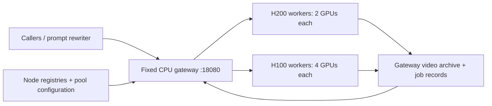

# H3 service design and redeployment runbook

This is the operating contract for Jeff's self-hosted **H3-Base FL2VA + four-step
FastH3 adapter** service. It covers `serve.py`, `serve_node.py`, `gateway.py`, and
the launchers in this directory. It does not use the separate SGLang deployment
instructions at the repository root.

**State on 2026-11-09 (H200).** 20 two-GPU H200 workers serve both request forms
through the gateway with [overlapped output publication](#overlapped-output-publication)
(`H3_ASYNC_PUBLICATION=1`).
- Slurm 25–29 hold all eight GPUs on
  `dc02-gpu-{002,003,005,006,023}.internal.bigbeargpu.cloud` (jobs 26, 27, 28, 25,
  29), four workers each on ports 18080–18083.
  - They run the read-only release
    `/home/jeff/sol-h3-h200/releases/20261109-async-publication-de684c517f65/Sol-H3`;
    each `/healthz` reports its `release.source_sha256`.
  - `deployment/jobs.json` records them. Evidence is in
    `deployment/async-publication-20261109/`.
- Validated on 2026-11-09 with 80 direct jobs, 20 jobs through the gateway URL
  that reached every worker, a back-to-back overlap check, and an encoder
  equivalence test on an H200. For the measured speed, see
  [Roll out overlapped publication](#roll-out-overlapped-publication).
- Node 035 was freed on 2026-11-09 at the user's request. Since 17:47 UTC that day,
  048 and 067 run another user's jobs (`deployment/release-2-nodes-20261109T174700Z/`).
  `pool.json` excludes the origins of all three nodes; leave them alone.
- Workers cap PyTorch's pool at 95% of the GPU after warmup (132.8 GiB), the H200
  default.
- The gateway host is `VM-187-Konsttech`, and user lingering is enabled. The hourly
  watchdog runs the release's watchdog files and restarts each worker with its
  allocation's release and publication mode.
- Since the cluster rebuild, `/raid` is root-owned. The fleet uses
  `/var/tmp/jeff-sol-h3` on each node. Its `launch.sh` sets `H3_BIND_HOST` to the
  node's `10.2.201.*` address, because the full hostname resolves to a USB
  link-local address.
- The 32-worker fleet of 2026-11-07 (Slurm 10–17, code `3718c71`) passed the
  extended validation on 2026-11-08: 256 mixed requests at 64-client concurrency
  and the T2V/I2V matrix (`deployment/fleet-32-dc02-20261107/finish-20261108/final-report.json`).
  Its inventory is under `previous_inventory` in `jobs.json`; do not use its job IDs.
- **H100, 2026-11-06.** Eight four-GPU H100 workers with sharded weights ran on GMI
  nodes gpu-001/004/005/006. On that cluster's Slurm, whose job IDs restarted after a
  rebuild, they were jobs 6, 5, 7 and 8. Each node ran two workers on loopback ports
  18080–18081, launched from `deployment/h100-fleet-20261106/`.
  - All eight passed direct validation (40 requests), then served a direct evaluation
    run.
  - **Stopped 2026-11-06 04:52 UTC at the user's request** (`scancel 5 6 7 8`); see the fleet README.
  - They never joined the gateway pool: the gateway host's SSH key had changed and
    was not confirmed (see [H100 workers](#h100-workers-on-another-cluster)).
  - The 2026-10-28 attempt (Slurm 3435) had failed because whole-pipeline ranks do not
    fit in 80 GB.

Do not interpret this document or a stale registry as an instruction to restart or
stop workers.

## Fixed caller contract

| Item | Contract |
|---|---|
| External base URL | **`http://10.2.201.187:18080`** |
| Gateway login from this workstation | `ssh h200-login` (configured relay and login key; see README) |
| Deployment root on that cluster | `/home/jeff/sol-h3-h200` |
| Bearer token | Existing `deployment/token`; keep private and preserve it |
| Submit | `POST /v1/videos` with the original JSON `{prompt, duration (5 or 10), seed}`, or the SGLang form `{task (t2va or fl2va), prompt, conditions, target, seed}` ([API.md](API.md#sglang-form)) |
| Request size | At most 28 MiB; a base64 first frame can be up to 20 MiB |
| Caller job ID | Optional `Idempotency-Key: <lowercase UUID>` header; it becomes the job ID |
| Poll / download | `GET /v1/jobs/{id}` / `GET /v1/jobs/{id}/video`, or SGLang's `GET /v1/videos/{id}` (`completed`) / `GET /v1/videos/{id}/content`; success includes `video_sha256` |
| Media | 24 FPS, stereo audio, four transformer forwards; 1344×768 by default, six aspect ratios or the first frame's own; 124–345 frames |

The caller-facing reference, with a tested example client, is [API.md](API.md);
keep it in step with this contract. The base URL, bearer token, API paths, and
existing job IDs survive worker pool changes. Preserve the gateway's `jobs/`, `videos/`, `uncertain/`, `pool.json`, and
`endpoint.json`. Worker ports are internal; retaining their existing ranges is
still useful when replacing an allocation on the same host. **Never move the
gateway onto a GPU Slurm allocation.**

`h3-gateway.socket` owns the listener on the persistent login host.
`deploy_h200_gateway.sh` checks the pinned `gateway/endpoint.json` and refuses
address drift. Ordinary worker scaling requires neither running that installer
nor restarting the gateway. Updating gateway code requires a service restart;
keeping the socket open preserves the address but does not guarantee that an
in-flight HTTP request survives a process restart. The new process reads every job
record before it answers. With 175,000 records on 2026-11-05 that took 35 minutes,
so restart only when the API can be unavailable that long.

Clients outside the private network use their own SSH tunnel, as described in
[the access guide](README.md#access-the-deployed-h200-service). Cluster access
and the token must be provisioned through the deployment owner. Do not copy a
private key into a document or put the bearer token into shell arguments/logs.
The prompt rewriter continues to use the gateway URL, independently of GPU type
and worker count.

## Request ownership, concurrency, and failures



Each worker runs one generation at a time, with eight waiting requests; with
[overlapped publication](#overlapped-output-publication) it can also be publishing
its previous video. The gateway chooses a healthy worker using observed queue
depth, accepted jobs, and submissions in progress. This is a bounded worker queue, not a durable global
queue for an arbitrary batch of 400 requests. With `W` healthy workers, there
are `W` generation slots and up to `8 × W` waiting slots. A useful initial caller
limit is `W` for latency-sensitive callers. Batch callers should keep about
`2 × W` jobs in flight. Recalculate after scaling; this is not a guarantee against
rejection or failure.

**Why `2 × W`.** From Oct 29 to Nov 2, sixteen workers were generating 46% of the time
(63% in busy hours). Every idle gap was a worker waiting while its caller polled,
downloaded, and submitted the next job, a median of 8 s. With about `2 × W` jobs in
flight, every worker has its next job queued, at the cost of up to one generation of
queueing per job. The analysis scripts are `util.py`, `newshape.py`, and `gaps.py`
in `deployment/stability-review-20261102/`.

**Time per job** depends on three things:
- the clip's length and task;
- whether the worker process has already compiled that prompt length;
- whether the sparse attention's numerical check rejected that length.

Measured on 2026-11-05, as processing time per video on two-GPU workers with the
serving cap:

| Clip | Warm, sparse | Warm, dense fallback | First request of a new length |
|---|---|---|---|
| 124 frames, 5.2 s | T2V 13.5 s, I2V 15.2 s | 17–19 s | 26–28 s |
| 243 frames, 10.1 s | T2V 32 s, I2V 34 s | 46–48 s | 42–53 s |
| 345 frames, 14.4 s | T2V 52 s, I2V 56 s | 79–82 s | 65–90 s |

The dense fallback ran for 6–25% of 5- and 10-second requests and for about half
of 14-second ones. A rejected length stays dense for the life of the worker
process. A 14.4-second clip occupies a worker about as long as four 5-second
clips, so size concurrency by worker time.

A job stays on the worker that accepted it, including while that worker is
excluded from new dispatch. The gateway copies and checks the MP4 before
publishing success. It keeps retrying status/archive operations after a transient
failure, without generating the video again. Completed archives remain available
with an empty worker pool, provided their storage is readable.

| Result | Caller behavior |
|---|---|
| 202 | Save the returned ID and poll it. With a key, repeating the same POST returns this job in its current state |
| 400 | `Idempotency-Key` is not a lowercase canonical UUID |
| 409 | The key was already used with different inputs (prompt, seed, duration or target, task, or first frame); nothing new started |
| 411, 413, 422 | No `Content-Length`, body over 28 MiB, or invalid or unsupported fields (including an undecodable first frame); fix the request |
| 429 | Request rejected before acceptance; retry with backoff and jitter |
| 503 | No worker currently available or service not ready; back off |
| 507 on POST | Storage rejected admission before acceptance; wait for recovery |
| 502 with `detail.id` / `detail.status_url` | Worker accepted, but gateway could not persist the route; poll that ID, **do not resubmit** |
| Other 502, POST timeout, or lost response | With a key: repeat the same POST and key; it is never generated twice. Without a key: do not repeat automatically; reconcile `uncertain/` |
| Terminal `failed` job | Read `error_code`; to regenerate, submit again with a **new** key |

### Caller job IDs

A caller that sends `Idempotency-Key` chooses the job ID: the gateway uses the
key as the job ID and passes it to the worker in the same header. There is no
separate request table and no new endpoint; `GET /v1/jobs/{key}` is the lookup.
Requests without a key get a random ID and behave as before. Gateway `/healthz`
reports `idempotency_key: true`, so a client can detect support.

- **Repeat.** Same key and inputs return the existing job, including a failed
  one. Different inputs return 409; a first frame is compared by its SHA-256. Concurrent repeats share one dispatch in the
  single gateway process.
- **Ambiguous outcome.** Before each POST the gateway writes
  `uncertain/<id>.json` naming the chosen worker. A repeat asks only that worker
  for the ID: found means adopt it; 404 means it was never accepted, so dispatch
  once more; no answer returns 502 again. A refused connection or connect timeout
  means nothing was sent, so the gateway tries the next worker at once.
- **Workers.** A worker returns its saved job for a repeated ID even when its
  queue is full, it is still loading, or the job failed. The gateway dispatches
  only to workers whose `/healthz` reports `idempotency_key: true`, so a worker on
  older code is never sent work; upgrade workers with the gateway.
- **SGLang form.** The gateway sends these requests only to workers whose
  `/healthz` reports `api.version` 2 and an `api.num_frames.max` that covers the
  request. With none ready it answers 503 with `Retry-After`. Original-form requests
  can go to any ready worker, so workers can be upgraded one at a time.
- **First frames.** The submission journal and job records keep each first frame
  only as format, size, and SHA-256, never as base64. The worker stores the image
  next to the job record, as `<id>.keyframe0.<ext>` in its output directory.
- **Failure codes.** Failed jobs carry `error_code`: `worker_restarted`,
  `inference_failed`, or `storage_failure` from the worker, and `worker_lost`
  from the gateway when a job's worker has been unreachable for 10 minutes (or
  an ambiguous submission is at least 10 minutes old and its worker still does not
  answer). Every code permits one explicit regeneration with a new key. A late
  result from a lost worker is never archived.
- **Results.** Successful status includes `video_sha256` and `video_bytes` of the
  archived MP4. Downloads can be repeated; nothing expires.

Not provided: a separate request lookup, cancellation, a regeneration endpoint,
or a second gateway. Deduplication lives in the gateway's `jobs/` and
`uncertain/` and in each worker's output directory; deleting them forgets those
IDs. The one token is the only caller scope. If the gateway process dies after
worker acceptance while both job-record and journal writes are failing, it can
still lose a keyless accepted ID. Worker restart still marks interrupted jobs
failed instead of replaying GPU work. Do not promise zero failed requests or
transparent recovery from node loss.

## Overlapped output publication

`H3_ASYNC_PUBLICATION=1` (`serve.py --async-publication`) lets a worker generate
the next video while it publishes the previous one. The launcher default, `0`,
publishes each MP4 before the next generation starts, as before. Since 2026-11-09 the
H200 fleet runs with `1`, which its `launch.sh` sets
([Roll out overlapped publication](#roll-out-overlapped-publication)).

**What changes.** After generation, rank zero copies the video into pinned host
memory and the GPU starts the next job. A background thread on rank zero finishes
the previous MP4: the rest of the x264 encode, the audio mux, inspection, fsync, the
atomic rename, and the terminal job record (`output_publication.py`). At most one
publication runs per worker. When the next video is ready to stage before the
previous publication ends, it waits for that slot, so a worker never holds more
than one encoder or one set of pinned frames besides the generation on its GPUs.
The model, adapter, request identities, media, queue capacity of eight, and the
two-GPU topology are unchanged. Model calls, CUDA work, and every collective stay
on the main thread. Warmups always publish synchronously, so readiness still
follows complete outputs.

**Expected gain.** In the r3 training run (42,738 videos) the time after
generation averaged 2.27 s of 40.9 s: 1.2 s for 5-second clips, 2.4 s for 10-second
clips, 3.4 s for 14-second clips. Because it grows with clip length, it is mostly
the encode tail, which this overlaps. The copy off the GPU and the rank handshake
stay on the GPU's path. The gain appears only when a worker already has its next
job waiting, which was true for 84% of r3 jobs. That allows at most 5.9% more videos
per worker-hour; an estimated 4–5%, less if the four workers on a node compete for
CPU. A job's own latency does not shrink, because it still reports success after its
MP4 is published; queued jobs start earlier.

**Measured on 2026-11-09.** One request (243-frame `fl2va`) produced byte-identical
videos in both modes on four workers:
- Synchronously, each video occupied the GPU for 28.18 s: a 26.29 s pipeline plus
  1.88 s of publication.
- Overlapped, the GPU slot averaged 26.12 s, 7.3% less. The pipeline did not slow down.
- The 2.79 s publication ran behind the next generation, 0.9 s slower than when it
  blocked the GPU. So a job that has no successor finishes about 0.9 s later.

The paired 64-job benchmark has not been run. GPU memory does not grow: the decoded video leaves the GPU when
it is staged, in both modes.

**Caller contract.** Status values stay `queued`, `running`, `succeeded`, and
`failed`, and the gateway needs no change or restart. A video is `running` until
its MP4 is published and its record written. While running, a job has an additive
`stage`: `generating`, `staging` (including the wait for the publication slot), or
`publishing`. `processing_s` keeps its meaning, generation start through
publication, and `pipeline_s` is unchanged.

**Timings.** Every job records `generation_started_at`, `generation_finished_at`,
`publication_mode`, `gpu_slot_s`, and `host` (resident memory, CPU time, load, and
PyTorch's pinned host pool, `pinned_gib`/`pinned_peak_gib`). Overlapped jobs add:
- `staged_at` and `published_at`: wall-clock times;
- `publication_slot_wait_s`: how long the video waited for the previous publication;
- `publication_tail_s`: staging to the published MP4;
- `encoder`: the encoder's phase timers. Its `elapsed_s` includes staging and the
  phases overlap, so do not add them up.

Adjacent jobs overlap, so the sum of `processing_s` no longer measures how long a
worker was occupied. Use `gpu_slot_s` (generation start to staging, including the
slot wait) or the `generation_started_at`..`staged_at` intervals, which do not
overlap, together with GPU telemetry. Do not reuse the r3 occupancy calculation
unchanged, and do not quote the 2.27 s as a measured saving.

**Health.** `/healthz` adds `gpu_active_job`, `publishing_jobs`,
`publication_capacity` (1 when overlapped, 0 otherwise), `publication_mode`,
`release` (`code_dir` and `source_sha256`, a digest of the running Python
sources), `drained`, `fatal_error`, and `process` (rank zero's `rss_gib` and
`cpu_s`, and the node's `load_1m`). `active_job` stays a busy indicator: the job on
the GPU, otherwise the job being published, until it is settled. The gateway
counts it as load. `drained: true` means nothing is queued, held, generating,
publishing, or waiting for a record write.

**Failures.**
- *Output storage.* A filesystem error while publishing (`ENOSPC`, `EDQUOT`, `EIO`,
  read-only, and the others `publish_media` treats as storage) fails that job with
  `storage_failure` and pauses admission at once (507). A video that is already
  generating reaches its staging boundary on every rank. If storage has not
  recovered by then, that job also fails with `storage_failure` and its frames are
  released. Queued requests wait for the usual recovery. Nothing is rendered again
  automatically.
- *Fatal.* Encoder, media, CUDA, and any other unexpected error remain fatal. A
  failed background publication fails its job with `inference_failed`, closes
  admission (status `failed`), and stops every rank at the next staging or command
  boundary.
  - On any fatal error, rank zero fails its held, generating, and queued jobs at
    once. It then gives an in-flight publication up to 10 s, and fails it if it
    is still running.
  - torchrun stops every rank as soon as one exits, and SIGTERM ends a rank at
    once. So in this mode, a rank that fails while serving waits up to 13 s before
    exiting; rank zero's exit ends that wait early.
  - If only the other rank fails, rank zero is stuck in a collective and is killed
    without settling its jobs. Its publication thread can still finish meanwhile.
    The jobs it could not settle fail with `worker_restarted` at the next start, as
    before.
  - The supervisor then restarts the worker. A result that arrives late never
    replaces a failure and is counted once.
- *Records.* A terminal record that cannot be written behaves as before: the job
  shows `running` with `persistence_pending` and the worker reports
  `storage_paused` until the write succeeds.
- *Restarts.* SIGTERM still ends a worker at once. On its next start, every job it
  had queued, generating, or publishing fails with `worker_restarted`, never
  replayed. Leftover `.partial.mp4` files and record temporaries are removed. An MP4
  renamed just before the kill, without its record, is never served.

**Launch settings.** `deploy_node.sh` exports `H3_ASYNC_PUBLICATION` (default `0`)
and `H3_CODE_DIR`, the service code the allocation runs (default
`$H3_DEPLOY_ROOT/Sol-H3`). `serve_node.py` starts every worker, including crash
restarts, from `H3_CODE_DIR` with `--async-publication` when the setting is `1`. It
records both in the node registry as `launch`. The watchdog passes them to
`run-worker.sh`, so its restarts use the same release and mode. `serve.py` refuses a
flag that disagrees with `H3_ASYNC_PUBLICATION`. Publication capacity is fixed at
one in this release.

## Storage isolation and safeguards

The 2026-10-24 incident showed `ENOSPC` and `EIO` on shared registry writes. An
unhandled heartbeat exception entered supervisor cleanup and killed all sibling
workers. Storage was writable again when inspected; those logs do not establish
whether the underlying cause was bytes, inodes, quota, or a transient filesystem
problem. Evidence is retained in
[`runs/minimax_h3_h200_storage_recovery_20261024`](../../../runs/minimax_h3_h200_storage_recovery_20261024/).

| Data | Location / behavior |
|---|---|
| GPU environment, weights, kernel caches | Node-local `$H3_LOCAL_ROOT`; normally `/raid/jeff` on H200 |
| Worker outputs and job records | `$H3_LOCAL_ROOT/sol-h3-service/<port>/`; preserve across restarts |
| Worker logs / readiness files | `$H3_LOCAL_ROOT/sol-h3-supervisor/<registry-name>/` |
| Supervisor stdout/stderr | `$H3_LOCAL_ROOT/sol-h3-supervisor/supervisor-<job>.log` |
| Shared discovery heartbeat | `$H3_DEPLOY_ROOT/deployment/<registry-name>/node.json`; best effort |
| Gateway job state / archive | `$H3_DEPLOY_ROOT/gateway/{jobs,videos,uncertain}/`; persistent storage |

The code now applies these rules:

- JSON records use unique temporary files, flush/fsync, and atomic replacement.
  Failed writes retain the previous record and attempt to remove temporary files.
  This is not a filesystem-wide transaction or a guarantee about remote storage
  surviving power loss.
- Staging is serialized per local root with `flock`. Capacity checks include
  missing checkpoint/environment bytes plus the free-space reserve before a copy
  starts. Existing environments and checkpoints are not overwritten. Prepared
  files on separate mounts are checked too; archive size is an estimate of
  extracted space, not a reservation.
- Admission checks free bytes and available inodes. Defaults are **20 GiB free**
  and at least **128 free inodes**. Actual writes still handle quotas, read-only
  mounts, and races that `df` cannot predict. These are stop thresholds, not
  recommended operating capacity.
- Workers return 507 before accepting a request if its metadata cannot be
  written. For an accepted job, failed metadata writes remain in memory and pause
  further inference/admission until they can be persisted. Status polling remains
  available for those jobs. A terminal result awaiting persistence is exposed as
  `running` with `persistence_pending: true`.
- An output filesystem error after inference is broadcast over the CPU control
  group to all ranks. That request fails; resident ranks can continue after
  storage recovers. CUDA errors, invalid media, numerical failures, and failed
  collectives still terminate the worker. Storage failure during warmup can still
  exceed the supervisor's 30-minute startup deadline.
- A failed shared heartbeat does not stop healthy processes. One unreadable
  registry is isolated. A last valid heartbeat may be used for **up to 300 seconds
  from its timestamp**, always with a fresh worker health probe; after 120 seconds
  it is reported stale. Explicit stopped/failed/disabled records and pool
  exclusions take precedence. An unreadable pool configuration stops new dispatch
  instead of forgetting manual exclusions. Accepted jobs still retain their route.
- The gateway checks the actual `jobs`, `uncertain`, and `videos` paths, including
  when mounted separately. It journals before POST. A known acceptance is tracked
  in memory even if its route cannot be written; a saved acceptance journal can
  reconstruct that route on restart. Archive failures leave the job pending and
  keep retrying its original worker. A saved video is not downloaded again merely
  because its metadata write failed, and completion is counted after persistence.
- `/healthz` includes storage observations, errors, and pending write counts.
  `storage_paused` returns HTTP 503 and removes a worker from new dispatch. This
  is not a reason to kill an already warm worker. Recovery probes resume work
  when storage is writable and the reserve is restored.

These paths handle reported I/O errors. A filesystem call that hangs indefinitely
can still block its process. The gateway host, its persistent storage, and network
remain shared dependencies; there is no second gateway or replicated job database.

A gateway restart reads every `jobs/*.json` before it answers. On 2026-10-28,
33,521 records on the shared MooseFS `/home` took about seven minutes; the socket
kept the address, but status and download requests waited until the scan ended.
Schedule gateway restarts accordingly.

### Capacity, retention, and incident response

Budget for model + adapter + environment + caches + both worker and gateway video
copies + logs + free reserve. Use the staging manifest for weight sizes and
measured MP4 sizes for output growth:

`daily output bytes = successful jobs/day × mean MP4 bytes`

Each local worker accumulates its share; the gateway accumulates the whole fleet.
More GPUs can fill the archive faster. **No automatic result expiry or log
rotation is installed by these changes.** Keep the present indefinite-download
contract until a retention policy is agreed. A future log rotation policy should
bound total log bytes and avoid deleting evidence for an active incident.

Before sustained traffic, monitor free bytes, inodes, quota, and filesystem errors
on both the gateway and every GPU node. A starting alert policy is free space
below the larger of 100 GiB or two days of measured output growth, plus a low-inode
alert well above 128. Monitor `storage.error`, `storage.pending_writes`, archive
backlog age, worker readiness, and restarts. These are operator recommendations;
no alerting service is installed here.

During an incident, preserve logs, job IDs, pool configuration, and Slurm state;
pause new admissions by merging the affected endpoints into `excluded_workers`.
Check `df -h`, `df -i`, quota, and the storage service's error reports on the actual
mounts. Restore space or fix the filesystem, then let persistence/archive retries
catch up. Keep workers alive while the gateway still needs their videos. Do not
delete `jobs/`, `uncertain/`, or completed archives to make a restart work. Only
remove obsolete staging partials, inactive caches, or old logs after checking
ownership and active jobs. Removing an open log does not necessarily release its
space. A deliberate archive migration needs backups, a read-only/drained cutover,
and verification of old job IDs and hashes before retiring the previous copy.

### Worker crashes, restarts, and the watchdog

**Known crash.** H200 workers crash in attention after a process has seen about
570 distinct prompt lengths (550–675). The error is either cuDNN SDPA
(`mha_graph.execute(...).is_good()`) or the Sol CUTLASS kernel
(`CUDA_LAUNCH_INVALID_CONFIG`). From Oct 29 to Nov 2 that took 15–59 hours per process. Each
crash fails the worker's running and queued jobs (`worker_restarted`, or
`worker_lost` after 600 s); callers regenerate with a new key. PyTorch's pool
stays flat, so the likely cause is kernels loaded outside the pool for each new
length on the GPU with the least free memory; the serving memory cap below leaves
room for them. The analysis and copied logs are in
`deployment/stability-review-20261102/`.

**Restart rule.** `serve_node.py` restarts a worker after every crash:
- A crash after at least 30 minutes of readiness starts a fresh count.
- A worker that fails three starts in a row is disabled; its siblings keep running.
- If every worker on the node is disabled, the supervisor exits with status 1 and
  the allocation ends. Slurm does not requeue it.

Until Nov 2 the three starts counted over the allocation's whole life. That
ended all four H200 allocations on Nov 2 between 09:51 and 13:41 UTC.

**GPU selection.** Workers get their pair by UUID. After a GPU faulted on 0023,
CUDA skipped it and renumbered every later GPU, while `nvidia-smi` indices did
not change.

**Serving memory cap.** On H200, `deploy_node.sh` sets
`H3_SERVING_MEMORY_FRACTION=0.95` by default (since 2026-11-05; `0` disables it).
After warmup each worker releases PyTorch's cached memory and caps the pool at 95%
of the GPU, 132.8 GiB.
- **Why.** Uncapped, the pool grows until the GPU is full. The largest SGLang-form
  requests (8,000-character prompt, 345 frames, 1856×576 canvas, dense fallback)
  left 0.6 GiB free of 140.4 GiB. That leaves no room for kernels and libraries
  outside the pool, which is the condition behind the crash above.
- **Measured with the cap.** On 2026-11-05, 200 requests covered every task,
  canvas, and length:
  - at most 128.0 GiB allocated, with the pool at or below 132.8 GiB;
  - at most 135.1 GiB in use per GPU, leaving at least 5.3 GiB outside the pool;
  - no slowdown compared with the uncapped run.
- **Trial.** 0002 ran with the cap from Nov 2. In the 50 hours to Nov 4 its four
  workers each served 828–848 distinct prompt lengths without a restart. Uncapped
  nodes crashed 41 times in the same period.

The cap must come after warmup. Loading needs more than serving, because about
24 GB of weights are freed during the first warmup. On Nov 2 a cap set at launch
(`PYTORCH_ALLOC_CONF=...,per_process_memory_fraction:0.95`) failed every worker in
`module.to()`.

**Watchdog.** The watchdog is a backstop on the gateway host. `watchdog/` holds the
code and units; the live copy is in `deployment/watchdog/`.
- What it does: once an hour `h3-watchdog.timer` probes every worker. It restarts
  a worker the supervisor has disabled, as an `srun --overlap` step in the same
  job, but only when the worker's GPUs are healthy and idle. The restarted step
  runs under `systemd --user` as `h3-worker-<node>-<port>`.
- What it never does: stop a worker that answers, or submit or cancel Slurm jobs.
- To keep it away from a worker, list the worker in `excluded_workers`.
- Nodes: `NODES` in `watchdog.py` and the node pattern in `run-worker.sh` list the
  fleet's nodes (002, 003, 005, 006, 023, 035, 048, and 067 since the 2026-11-07
  rebuild). The watchdog ignores any other node. Each node's job must be named
  `h3-api-<node>-p18080`. Since 2026-11-09, `excluded_workers` keeps it away from
  035, 048, and 067, which no longer run H3 workers.
- Restarted workers: `run-worker.sh` starts a worker with the same environment and
  arguments as `serve_node.py`, including `H3_SERVING_MEMORY_FRACTION=0.95`. It also
  takes the allocation's launch settings (publication mode and code directory),
  which `watchdog.py` reads from the node registry's `launch` block. The watchdog
  restarts a worker only when that registry belongs to the node's running job.
  Allocations started before these settings existed restart as before:
  synchronous, from the shared `Sol-H3/`. After changing either file, compare them
  with `watchdog/env_check.py`, which also checks each worker's code directory:
  `srun --jobid=<job> --overlap --nodes=1 --ntasks=1 python3 env_check.py run-worker.sh`.
- Shared `/home`: `~/.config/systemd/user` is on shared `/home`, so the unit has
  `ConditionHost=` and the script takes a host-local lock in `/run/user/<uid>`.
  On Nov 2 a lock on shared storage, held by another host's copy of the timer,
  silently blocked every run from 06:00 to 17:06.
- Install, check and pause:

  ```bash
  cp watchdog/watchdog.py watchdog/run-worker.sh watchdog/env_check.py /home/jeff/sol-h3-h200/deployment/watchdog/
  cp watchdog/h3-watchdog.{service,timer} ~/.config/systemd/user/
  systemctl --user daemon-reload && systemctl --user enable --now h3-watchdog.timer
  python3 deployment/watchdog/watchdog.py --dry-run   # report only; a healthy run ends with "summary:"
  systemctl --user stop h3-watchdog.timer             # pause
  ```

Neither the supervisor nor the watchdog sends alerts. Check the watchdog log
and node registries, not just the gateway's `workers_ready`.

## Parameterize the next fleet

Record the supplied hostnames and addresses before submitting any job. Include
cluster/login, Slurm partition/GRES, GPU family and allocation size, local root,
base port, gateway-reachable origin, CPU/RAM limits, and any SSH tunnel mapping.
The following defaults are implemented; they do not select available nodes:

| Setting | Default / use |
|---|---|
| `H3_GPU_TYPE` | `H200`; set `H100` explicitly for H100 nodes |
| `H3_GPUS_PER_WORKER` | 2 on H200, 4 on H100; accepted values 2 or 4, divisible into the allocation |
| `CUDA_VISIBLE_DEVICES` | Slurm's assigned GPUs; never replace with a node-wide list. The supervisor passes each worker its pair's UUIDs |
| `H3_SERVING_MEMORY_FRACTION` | `0.95` on H200 (the `deploy_node.sh` default since 2026-11-05), unset elsewhere; `0` disables it. Caps PyTorch's pool after warmup (see [Worker crashes](#worker-crashes-restarts-and-the-watchdog)). Required with the SGLang request form on two-GPU H200 workers: the largest requests need 128.0 GiB, and an uncapped pool filled the GPU |
| `H3_WEIGHT_SHARDING` | `1` on H100 (the `deploy_node.sh` default since 2026-11-06), unset elsewhere; `0` disables it. Splits the text encoder's decoder layers and the DiT blocks across the worker's GPUs and gathers each block just before it runs (`h3_runtime/weight_sharding.py`). Required on 80 GB GPUs, where one rank's whole pipeline (about 129 GiB) does not fit |
| `H3_BASE_PORT` | 18080; one consecutive port per worker |
| `H3_DEPLOY_ROOT` | `/home/jeff/sol-h3-h200`; code, token, registry on the worker's cluster |
| `H3_LOCAL_ROOT` | `/raid/jeff`; override after checking the destination mount |
| `H3_VENV` | `$H3_LOCAL_ROOT/sol-h3-venv`; a prepared Python 3.12 service environment |
| `H3_CHECKPOINT_ROOT` | `$H3_LOCAL_ROOT/sol-h3-checkpoints`; existing model/adapter layout |
| `H3_BIND_HOST` | Node IP by default; `127.0.0.1` for SSH-forwarded workers |
| `H3_MIN_FREE_GIB` | 20; node staging/output reserve. Gateway has its own `--min-free-gib` |
| `H3_MAX_NUM_FRAMES` | Unset (345, the API maximum). A lower 17n+5 value caps what the worker admits and advertises; the gateway then routes longer requests elsewhere |
| `H3_ATTENTION_BACKEND` | `sol`. `dense` runs dense attention only; used to measure the gate-fallback path's memory |
| `H3_ASYNC_PUBLICATION` | `0`: publish each MP4 before the next generation. `1`: publish in the background while the next video generates, one publication at a time ([Overlapped output publication](#overlapped-output-publication)). Recorded in the registry and reused by watchdog restarts |
| `H3_CODE_DIR` | `$H3_DEPLOY_ROOT/Sol-H3`. The service code this allocation runs; point it at an immutable release directory so later changes cannot reach running workers. Recorded in the registry and reused by watchdog restarts |

An eight-GPU H200 allocation gives four workers; eight H100 GPUs give two
four-GPU workers. They can coexist behind the same gateway. CPU affinities are
split across the workers; encoder threads remain eight each. Each allocation
must have at least 32 logical CPUs. Do not run two allocations on overlapping
ports: the base port also selects a separate registry/runtime directory. Reusing
a port means reusing its local output directory, which is necessary for old job
records; never delete it as part of a code update.

H100 and H200 use the Hopper kernel path in this runtime. Whole-pipeline ranks do
not fit on 80 GB H100s (2026-10-28, see [below](#h100-workers-on-another-cluster)).
With `H3_WEIGHT_SHARDING=1`, each GPU of a four-GPU H100 worker holds 20.6 GiB of
block shards. Measured on 2026-11-06:
- 61.4 GiB allocated on the first request, before the AdaLN precompute frees
  `adaln_proj`;
- at most 46.9 GiB allocated and 52.6 GiB reserved afterwards, including 345-frame
  T2V and I2V requests.

Two-GPU H100 workers would not fit 345-frame requests even with sharding, so keep
four GPUs per worker on H100. Keep the four-step adapter, numerical gate, and dense
fallback; do not relax tolerances to make a deployment pass.

The historical H200 environment tar contains absolute interpreter/shebang paths
for `/raid/jeff/sol-h3-venv` and shared Python. It is not a portable environment for
another cluster. Prepare a Python 3.12 environment at the destination path using
[the Sol-H3 setup](README.md#setup), install `requirements-service.txt`, verify
the CUDA/cuDNN stack, and populate `H3_CHECKPOINT_ROOT` with the checksummed model
and adapter. The launcher refuses to unpack that tar into another environment
path or onto H100. Previously inspected H100 nodes had no `/raid`; a proposed
`/var/tmp/jeff-sol-h3` must be capacity-checked and may be ephemeral. Do not assume
those earlier observations still describe the next nodes.

## Redeploy, validate, then admit

Run this procedure only when deployment is requested. Keep unrelated models and
allocations untouched; GPU idleness shown by `nvidia-smi` does not establish Slurm
ownership or availability.

1. Inspect the actual gateway endpoint pin, service/socket status, pool settings,
   pending jobs, and deployment inventory. Snapshot them under a new dated
   `deployment/redeploy-.../` directory. `deployment/jobs.json` records the
   desired state and the current job IDs. It is an operator inventory, not an
   automatic restart controller.
2. Allocate only the supplied, scheduler-available GPUs. Reserve nonoverlapping
   internal ports and outputs; verify the GPU family, CPU/RAM capacity, and
   writable storage. Add prospective worker origins to `excluded_workers` before
   launch, merging with the existing pool file. Keep other settings/exclusions.
3. Stage a versioned copy of this complete service directory, including
   `service_storage.py`, `storage_preflight.py`, and `deploy_node.sh`, with the
   model environment/weights. Preserve tokens, registries, job records, archives,
   and known-good source for rollback. Do not update files under a running worker
   that may lazily import them; drain its allocation before switching code.
4. If applying these gateway changes, first quiesce external POST callers, set the
   pool to admit no new work, and wait for submissions in progress to finish.
   Back up state, install code, and restart **only `h3-gateway.service`** while
   retaining `h3-gateway.socket`. Confirm the same address, token, and old downloads.
   Do not replace the whole pool file to undo the pause: restore its saved fields.
5. Submit the prepared workers. These are examples to adapt to the supplied
   cluster's partition, GRES, node names, CPU/memory, and wall-time limits:

   ```bash
   # On the H200 cluster, after exclusions and preflight:
   sbatch --partition=all --nodes=1 --ntasks=1 --cpus-per-task=160 --mem=1600G \
     --gres=gpu:nvidia_h200:8 --constraint=h200 --time=0 \
     --export=ALL,H3_GPU_TYPE=H200,H3_GPUS_PER_WORKER=2,H3_BASE_PORT=18080 \
     --nodelist=SUPPLIED_H200_NODE /home/jeff/sol-h3-h200/Sol-H3/deploy_node.sh

   # On the H100 cluster, with the environment/weights already prepared:
   export H3_DEPLOY_ROOT=/home/jeff/sol-h3-h100
   export H3_LOCAL_ROOT=/var/tmp/jeff-sol-h3
   export H3_GPU_TYPE=H100 H3_GPUS_PER_WORKER=4 H3_BASE_PORT=18080
   export H3_BIND_HOST=127.0.0.1
   sbatch --partition=SUPPLIED_PARTITION --nodes=1 --ntasks=1 \
     --cpus-per-task=SUPPLIED_CPUS --mem=SUPPLIED_MEMORY \
     --gres=SUPPLIED_EIGHT_H100_GRES --time=SUPPLIED_LIMIT \
     --export=ALL --nodelist=SUPPLIED_H100_NODE "$H3_DEPLOY_ROOT/Sol-H3/deploy_node.sh"
   ```

   Capture the returned job IDs and the expected endpoint-to-job mapping in the inventory.
   The launchers do not submit jobs themselves or automatically recreate cancelled
   jobs. A second allocation on the same H200 host can use base port 18082 when
   the first owns only 18080–18081; verify both ranges before submission.
6. Wait for each worker's `/healthz` to report ready after two warmups at each
   original duration. Match these against the plan: `slurm_job_id`, GPU family,
   group size, gate policy, `api` (version 2 and `num_frames.max`), and assigned
   GPU UUIDs. Check each worker log for its `SERVING_MEMORY_CAP` line.
   Exercise **every worker and every allocated GPU** with:
   - original-form 5-second and 10-second requests, including the previously
     gate-rejected prompt;
   - SGLang-form requests at 345 frames, at least one of them with a first frame.

   Validate four forwards, dimensions/FPS/audio, downloaded bytes/hashes, fallback
   counters, and no unexpected process restarts. Record timings after warmup.
   `validate.py` in `deployment/rollout-api-v2-20261105/` runs these checks
   (`workers` before admission, `gateway` after).
   For a change to the request contract or the decode, first rerun the test
   phases (`driver.py` in `deployment/api-v2-validation-20261105/`) on test workers
   behind a test gateway. H100 validation must include concurrent workers on the same node.
7. Remove only the validated endpoints from exclusions (or add them to an existing
   explicit `workers` allowlist). Do not clear a global pause or unrelated
   exclusions accidentally. Verify gateway capacity, then run a small authenticated
   batch through the **unchanged external URL**, checking route coverage and
   downloads. Under live traffic, caller jobs can fill the idle new workers before
   the batch arrives, so the batch lands on older workers. Then check the caller
   jobs on the new workers instead: `live_routes.py` in
   `deployment/scale-0048-0067-20261104/` compares each job's SHA-256 on the
   worker, in the gateway record, and in the archive. Test an old completed job
   while its worker is excluded. Start caller concurrency conservatively and
   increase using observed latency/rejections.
8. Record the final worker set, Slurm IDs, ports, code/environment versions, GPU
   UUIDs, storage observations, and validation results. Update `desired_state` to
   running only for this explicitly requested, validated deployment.

### H100 workers on another cluster

The gateway must reach each worker, and the worker must retain the same bearer
token. A registry on another cluster's `/home` is not automatically visible to the
H200 gateway. The H100 nodes are on the GMI cluster, whose login host is
`utopai-m1` (where `sbatch` runs); its deployment root is `/home/jeff/sol-h3-h100`
with a copy of the same `deployment/token`.

GMI node addresses are public, so workers bind to loopback
(`H3_BIND_HOST=127.0.0.1`). The gateway host holds no credentials for the GMI
cluster, so the allocation opens the tunnel in reverse with the existing key:
gateway-host `127.0.0.1:28084`/`28085` → node `127.0.0.1:18080`/`18081`.
The tunnel runs in a restart loop inside the allocation and ends with it:

```bash
ssh -i ~/.ssh/gmi -p 44222 -N -o BatchMode=yes -o ExitOnForwardFailure=yes \
  -o ServerAliveInterval=30 -o ServerAliveCountMax=3 \
  -R 127.0.0.1:28084:127.0.0.1:18080 -R 127.0.0.1:28085:127.0.0.1:18081 jeff@157.66.255.187
```

Use distinct gateway-local ports for every additional node. If a network drop
leaves the old session holding a port, the loop keeps failing with "remote port
forwarding failed"; stop that stale `sshd: jeff` session on the gateway host
(`ss -ltnp | grep 2808`) and the loop rebinds.

The 2026-10-28 deployment (`deployment/h100-004-20261028/` on the GMI cluster)
prepared the node this way:

- **Environment.** `build_venv.sh` built a Python 3.12.15 environment on the login
  host at the node's path, `/var/tmp/jeff-sol-h3/sol-h3-venv`, from the H200
  workers' exact package list. The login host has no `nvcc`, so the
  `cudnn-frontend` source build was replaced by the identical compiled package
  from the H200 environment. The resulting freeze matches H200. The archive
  `sol-h3-venv-h100.tar` and its SHA-256 sit beside the script.
- **Weights.** Downloaded from Hugging Face at the pinned model/adapter revisions
  into `deployment/staging/` and verified against the H200 manifest checksums.
  `deploy_node.sh` copies and re-verifies them on the node.
- **Launch.** `launch.sh` runs a node preflight (GPU family, idle GPUs, free
  ports, 250 GiB on `/var/tmp`, gateway SSH reachability), verifies and unpacks
  the environment if absent, starts the tunnel loop, then runs `deploy_node.sh`:

```bash
sbatch --partition=all --nodes=1 --ntasks=1 --cpus-per-task=160 --mem=1600G \
  --gres=gpu:nvidia_h100_80gb_hbm3:8 --constraint=h100 --time=0 --requeue \
  --job-name=h3-api-h100-004 --nodelist=gmicloud-loki-gpu-004 \
  --chdir=/home/jeff/sol-h3-h100/deployment/h100-004-20261028 \
  --output=/home/jeff/sol-h3-h100/deployment/h100-004-20261028/node-004-%j.log \
  /home/jeff/sol-h3-h100/deployment/h100-004-20261028/launch.sh
```

Submit it from a shell without an activated virtual environment, because
`sbatch` exports the caller's environment. `/var/tmp/jeff-sol-h3` holds the
environment, weights, caches, logs, and job outputs on node NVMe; it persists
across allocations but should not be assumed to survive node reimaging.

**Result: the model does not fit.** Preflight, environment, weight copy, and the
tunnel all worked, but both workers ran out of GPU memory in
`MiniMaxH3Inference.__init__` (`self.pipe.to(self.device)`) on all three
attempts; the supervisor disabled them and released the allocation after 16
minutes. Every rank holds the full pipeline (62 GiB text encoder plus 62 GiB
transformer in BF16, plus VAEs; an H200 rank peaked at 129 GiB allocated), and
context parallelism splits activations, not weights, so four GPUs per worker do
not help. The environment archive and verified weights from that attempt are still
used. gpu-004 was reimaged before 2026-11-06, so its node-local copies are gone.

**2026-11-06: sharded four-GPU workers fit.** `H3_WEIGHT_SHARDING=1` (the H100 default)
changes only how the weights are placed:
- **Load.** The DiT loads whole for the LoRA merge and the installs; the text encoder
  stays on the CPU until it is sharded.
- **Sharding.** Each rank keeps 1/4 of every DiT block and text-encoder decoder layer.
  A forward pre-hook all-gathers the next block on a separate NCCL group and stream.
  The values are copied, never transformed: `tests/test_weight_sharding.py` checks
  that the outputs equal the replicated ones bit for bit on 2 and 4 GPUs.
- **Replicated parts.** `adaln_proj` stays whole until the AdaLN precompute frees
  it. The VAEs, the token refiner and the text encoder's embeddings and vision tower
  stay whole too.
- **Dropped parts.** The text encoder keeps 51 of its 64 decoder layers and drops its
  LM head. MiniMax-H3 reads `hidden_states[50]`, which is unchanged; the test checks
  this too.

The fleet ran from `deployment/h100-fleet-20261106/` on the GMI cluster:
- `launch.sh` and `preflight.py` refuse a node outside `nodes.json`, a GPU with a
  volatile uncorrected ECC error or a pending or failed row remap, a busy GPU or port,
  and less than 250 GiB free on `/var/tmp`.
- `validate.py` runs on the node as an `srun --overlap` step against both workers at
  once.
- A fresh node is ready 11 minutes after submission, including the 136 GB weight copy.

Measured on gpu-004 with both workers running (processing time, through the MP4):

| Request | Time |
|---|---|
| 5 s, warm | 8.4 s |
| 10 s, warm | 18.3 s |
| 10 s, gate-rejected prompt (dense) | 33.8 s |
| 345-frame T2V / I2V, first use of the length | 42.2 s / 45.1 s |
| 9:16 5 s, first use of the shape | 21–22 s |

Each node's allocation owns its reverse tunnel. The tunnel starts only once
`tunnels-enabled` exists in the fleet directory. The gateway host's SSH key changed
between 2026-11-05 and 2026-11-06, so `known_hosts` must be updated before the
tunnels can start. Gateway ports:

| Node | Gateway port → node port |
|---|---|
| gpu-004 | 28084 → 18080, 28085 → 18081 |
| gpu-001 | 28086 → 18080, 28087 → 18081 |
| gpu-005 | 28088 → 18080, 28089 → 18081 |
| gpu-006 | 28090 → 18080, 28091 → 18081 |

To admit the workers:
1. Run `pool_h100.py exclude` on the gateway host. It adds the eight origins to both
   `additional_workers` and `excluded_workers`, keeping every other entry.
2. Create `tunnels-enabled`.
3. Validate each origin through its tunnel.
4. Run `pool_h100.py admit <origin>...`.

The H200 watchdog cannot reach the GMI cluster, so only `serve_node.py` restarts
these workers.

Merge gateway-reachable origins into `pool.json`'s `additional_workers` while
retaining automatic H200 discovery and current exclusions:

```json
{"additional_workers": ["http://127.0.0.1:28084", "http://127.0.0.1:28085"]}
```

This is a field to merge, not a replacement for the existing pool file. If
`workers` is present, it is the complete explicit allowlist and takes precedence;
`{"workers": []}` still means globally paused. Failed tunnel health removes those
workers from dispatch; it does not change the external URL. Preserve a tunnel
mapping until its accepted jobs have been archived, and drain it before remapping
that origin to another worker/node.

## Drain, stop, rollback

Exclude the affected endpoints, stop direct callers, and wait for every accepted
gateway job on them to be failed or `video_cached: true`, with no pending metadata
writes. Also verify each worker has `active_job: null`, `queued: 0`, and no pending
writes; workers with overlapped publication report all of this as `drained: true`,
which also covers a publication still in progress. Worker success alone is not
enough: the gateway must also have archived the video. If storage is impaired,
inspect in-memory health as well as disk records; an old on-disk status is not
sufficient evidence of a completed drain. The supervisor gives a worker 15 s after
SIGTERM, so a stop never drains a queue by itself.

Cancel only the recorded H3 job IDs with `scancel`. Retain output directories,
tokens, gateway state, and exclusions. Confirm allocations are gone, the GPU
processes are gone, and unrelated workloads are unaffected. Set the operator
inventory to stopped and retain stop evidence. Keep the gateway/socket serving
old jobs; zero-worker health returning 503 is expected.

For rollback, exclude and drain only changed workers, restore their known-good
code/environment, and rerun the validation before admitting them. Restore gateway
code under the same socket and state directory; never roll its job database back
over newer accepted records. A forced stop can interrupt requests and must be
recorded as such. There is no automatic redeploy/requeue loop after intentional
cancellation.

## Roll out overlapped publication

This procedure comes from the r3 handover
(`/home/jeff/reports/grpo-r3-efficiency-20261109/SANA_WORKER_HANDOVER.rst`). The
gateway, its URL, token, job records, and archives stay untouched, and the gateway
is not restarted.

**2026-11-09 deployment** (`deployment/async-publication-20261109/`, with its README
and `actions.log`):
1. Node 006 was the canary. It ran the encoder equivalence test, then the release in
   synchronous mode (job 24).
2. The user asked to redeploy every worker without finishing the paired benchmark
   (step 5). So 006 was relaunched with overlap (job 25), validated, and checked for
   back-to-back overlap.
3. 002, 003, 005, 023, and 035 were then replaced together (jobs 26–30). At the
   user's request, 035 was freed again before validation. The other four were
   validated directly and through the gateway, then admitted.

The steps below are the full procedure; use them for the next rollout.
Replace one allocation (four workers) at a time.

1. **Reconcile and snapshot.** In a new `deployment/async-publication-<date>/`, save
   `jobs.json`, `gateway/pool.json`, `gateway/endpoint.json`, `squeue -u jeff`, every
   `deployment/dc02-gpu-*/node.json`, each worker's `/healthz`, the watchdog files and
   units, and the SHA-256 of every file in the live `Sol-H3/`. The live workers run
   `3718c71`. This release also carries `0cdeb00` (H100 weight sharding, inactive on
   H200 because `H3_WEIGHT_SHARDING` is unset there) and the watchdog and
   documentation changes since; record these differences in the evidence.
2. **Stage an immutable release.** Copy the complete `Sol-H3/` of the released
   commit, record its digest, and make it read-only:

   ```bash
   R=/home/jeff/sol-h3-h200/releases/<date>-async-publication-<commit>/Sol-H3
   mkdir -p "$R" && rsync -a --exclude __pycache__ <released Sol-H3>/ "$R/"
   (cd "$R" && python3 -c 'import service_storage as s; print(s.source_digest("."))') > "$R/../source_sha256"
   chmod -R a-w "$(dirname "$R")"
   ```

   Leave the shared `Sol-H3/` alone: running allocations import from it. Install the
   new `watchdog.py`, `run-worker.sh`, and `env_check.py` (see the watchdog section)
   and run `watchdog.py --dry-run`; allocations without launch settings restart as
   before.
3. **Drain the canary.** Pick one node. Merge its four origins into
   `excluded_workers`, keeping every other entry, and stop direct submissions to
   them. The exclusion also keeps the watchdog away. Wait for the
   [drain](#drain-stop-rollback): every gateway job on those workers failed or
   `video_cached: true`, and each worker idle (`drained: true` once it runs this
   release). Then `scancel` only that node's job.
4. **Relaunch it synchronously.** While the node is free, run
   `python -m pytest -q tests/test_encoder_equivalence.py` from the release in a
   short one-GPU job there: the background path must decode to the same frames and
   audio as the synchronous one. Reuse the fleet's `launch.sh` and `preflight.py`
   (`deployment/fleet-32-dc02-20261107/`) in the new directory, exporting
   `H3_CODE_DIR=$R` and `H3_ASYNC_PUBLICATION=0` and running
   `$H3_CODE_DIR/deploy_node.sh`. Keep the `/var/tmp/jeff-sol-h3` local root, the
   bond0 `H3_BIND_HOST`, ports 18080–18083, the job name `h3-api-<node>-p18080`, and
   the sbatch shape. When the workers are ready, check each `/healthz`
   (`publication_mode`, `release.source_sha256`, `slurm_job_id`), the
   `SERVING_MEMORY_CAP` lines, `env_check.py`, and direct validation
   (`validate.py workers` for the four origins).
5. **Benchmark both modes.** With the origins still excluded, run
   `publication_benchmark.py run` against the four workers: a manifest of at least
   64 requests covering the production mix of tasks, lengths, aspect ratios, and long
   prompts; `--inflight 2`; one warm pass. Repeat with `--inflight 1`, the case with
   no waiting request. Sample GPU utilization and memory on the node meanwhile with
   `monitor_gpu.py` from `finish-20261108/test-suite/`, as an `srun --overlap` step.
   Then drain, `scancel`, relaunch with
   `H3_ASYNC_PUBLICATION=1`, validate, and run the same benchmarks.
   `publication_benchmark.py compare SYNC_DIR ASYNC_DIR` gives the comparison.
   Proceed only if all of these hold:
   - `throughput_ratio` is above 1 in repeated runs; rerun both modes while the
     difference is within run-to-run noise;
   - p50 and p95 end-to-end latency are not materially worse, and nothing failed;
   - `gate_fallback_jobs` match between the runs, or the comparison measures the
     numerical gate instead of publication;
   - the trace shows the overlap (`visible_before_next_gpu_finished` above 0) and
     `max_publishing_jobs` is at most 1;
   - RSS, pinned memory, and load stay flat on all four workers of the node.

   Otherwise return the canary to `H3_ASYNC_PUBLICATION=0`.
6. **Admit the canary.** Remove only its four origins from `excluded_workers`. Run a
   small gateway batch and an old-result download through the unchanged URL, and
   record each worker's `release` and `publication_mode`.
7. **Roll the other seven allocations**, one at a time, through steps 3, 4 (in the
   validated mode), and 6; the benchmark runs only on the canary. For the final
   check, adapt `finish-20261108/test-suite/run_suite.py` in a new evidence
   directory. It hardcodes 32 workers, reads Slurm IDs from `jobs.json`, and resumes
   from `suite-summary.json`, so never reuse a completed summary.
8. **Finish.** Run the full API, media, and route validation and the 64-client mixed
   stress test. Inspect every GPU, restart counts, storage backlog, `publishing_jobs`,
   and watchdog parity. Update `jobs.json`, this document, and the README with the
   release, mode, job IDs, and measurements.

**Rollback** uses the same exclusion and drain. Relaunch the allocation with
`H3_ASYNC_PUBLICATION=0` on the same release, or with
`H3_CODE_DIR=/home/jeff/sol-h3-h200/Sol-H3` for the previous code; then validate and
readmit it. Never restore an older gateway job database, and keep each worker's
output directory.

## Local verification before rollout

With the gateway/service HTTP dependencies and pytest installed, run from the
repository root (no GPU or Slurm allocation required):

```bash
python -m pytest -q models/minimax_h3/Sol-H3/tests/
bash -n models/minimax_h3/Sol-H3/deploy_node.sh
bash -n models/minimax_h3/Sol-H3/watchdog/run-worker.sh
```

The tests inject ENOSPC/EIO/quota/read-only failures, exercise admission versus
post-acceptance recovery, archive retries, registry isolation, bounded discovery
grace, explicit pauses, and disjoint H100/H200 launch groups. They also cover
repeated, concurrent, and conflicting keys; a lost acceptance response before and
after a gateway restart; refused connections; worker loss; and exclusion of
workers without job ID support. `test_request.py` covers the SGLang form:
- tasks and canvases, checked against Diffusers' own function when it is installed;
- every frame count;
- base64 images and their limits;
- rejected fields.

`test_output_publication.py` covers overlapped publication with a fake encoder and
gated generation:
- the next video generates while the previous one publishes and downloads;
- one publication slot, and frames never reused while an encoder holds them;
- per-job metadata, idempotency keys in every state, and queue capacity;
- injected `ENOSPC`, `EDQUOT`, `EIO`, and read-only failures in the encoder, fsync,
  rename, and record write;
- fatal encoder, media, and staging errors, the same collective order on 2 and 4
  thread ranks, and a bounded shutdown that a late result cannot undo;
- a real two-rank `torchrun` run in which both ranks fail while a publication is
  still finishing: the publication must succeed;
- restarts after a real SIGKILL during encoding, after the rename, and during a
  record write.

`test_launch.py` covers the flag and `H3_ASYNC_PUBLICATION`, the supervisor's mode
and code directory, the watchdog's restart arguments, and `run-worker.sh` parity.
`test_gateway.py` runs overlapped workers beside old ones through the unchanged
gateway.

The suite has 196 cases on 2026-11-09 (186 run without a GPU). The large GPU case in
`test_lora_fusion.py` is skipped unless `H3_RUN_LARGE_GPU_TESTS=1`;
`test_encoder_equivalence.py` needs one free GPU (rollout step 4). Threads stand in
for ranks and a fake for the encoder; they do not replace the live distributed GPU
validation in the redeployment procedure.
